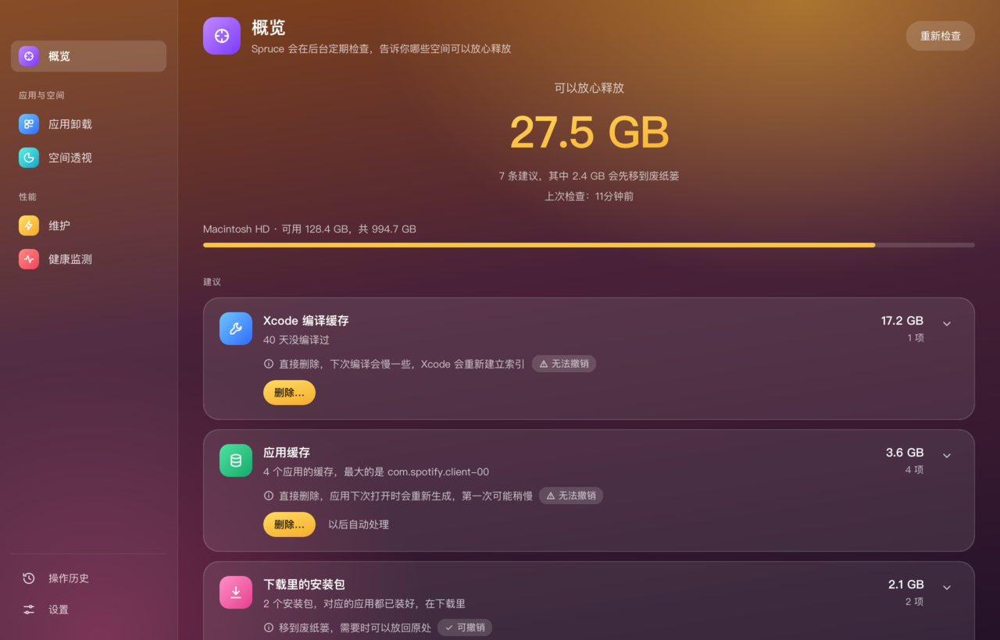
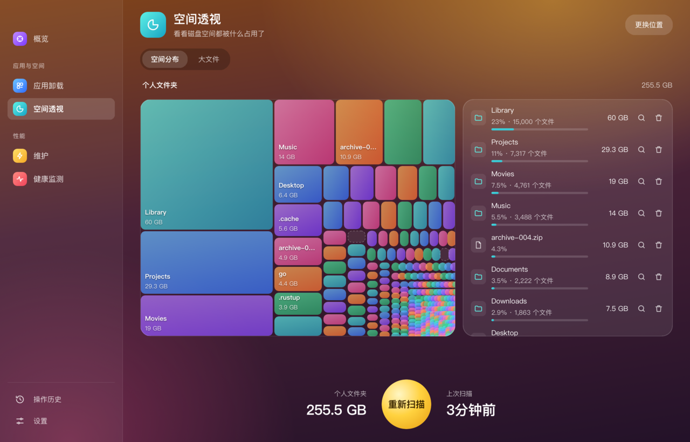
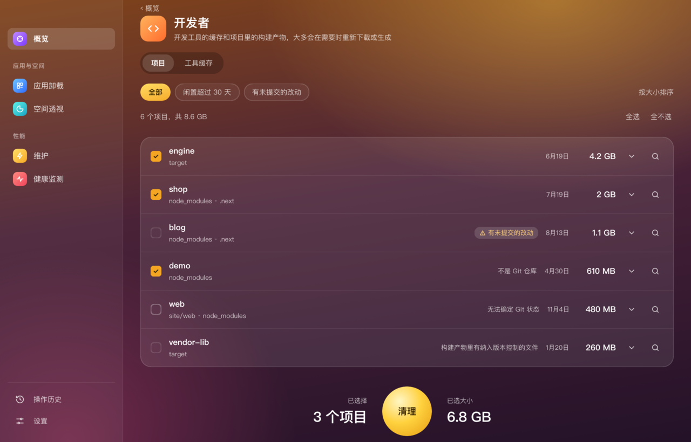
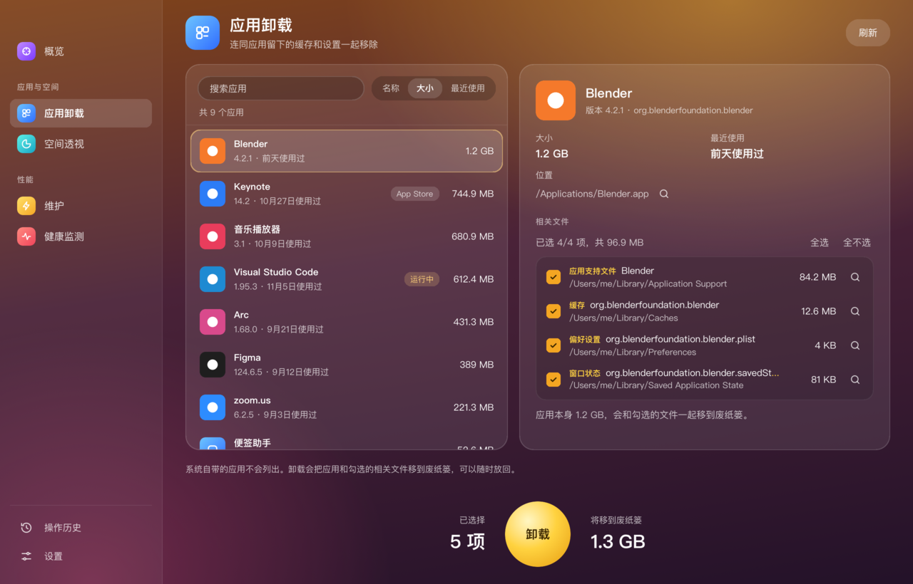
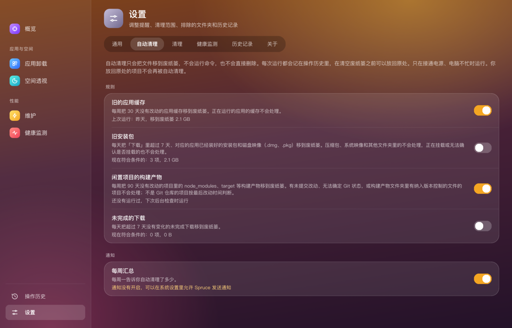
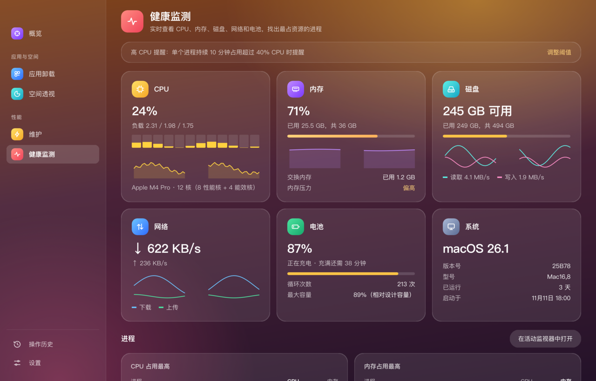

# Spruce

[](https://github.com/yldm-tech/spruce/actions/workflows/ci.yml)
[](https://github.com/yldm-tech/spruce/actions/workflows/release.yml)
[](https://github.com/yldm-tech/spruce/releases)
[](LICENSE)
[](#対応プラットフォーム)

[English](README.md) · [简体中文](README.zh-CN.md) · 日本語 · [繁體中文](README.zh-TW.md) · [한국어](README.ko.md)

Spruce は macOS と Windows 向けのディスククリーナーです。バックグラウンドでディスクを確認しておき、開いたときにはもう、安心して空けられる容量、削除する項目とその理由、元に戻せるかどうかがわかっています。アプリのアンインストール、ディスクを占めているものとその増え方の表示、メンテナンス作業、システムの状態の監視もできます。Go で書かれ、[NSGo](https://github.com/nsgo-dev/nsgo) の上に作られています。Web サイト：[spruce.yldm.ai](https://spruce.yldm.ai/ja/)。

インターフェースは簡体字中国語のみのため、スクリーンショットも中国語です。以下ではアプリの表示をそのまま引用し、意味を添えています。



## できること

- **概要（概览）。** スキャンボタンはありません。Spruce はウインドウを開いたときとバックグラウンドで、読み取り専用の 3 つの対象（システムジャンク「系统垃圾」、開発者「开发者」、インストーラ「安装包」）を確認し、結論（「可以放心释放 18.7 GB」＝安心して 18.7 GB 空けられます）、前回確認した時刻、再確認ボタン「重新检查」をすぐに表示します。前回の結果は次の起動時に表示され、その間に新しい確認が走りますが、キャッシュされた結果から削除することはありません。
- **チェックボックスではなく、提案。** 各カードは理由と結果を添えた 1 つの操作です。たとえば Xcode のビルドキャッシュ、しばらく触っていないプロジェクトのビルド成果物、ダウンロードフォルダのインストーラなど。サイズと安全性の順に並び、ボタンは 1 つ、項目は展開部分に入っています。各カードには、ゴミ箱に入れる（元に戻せる）のか、再生成されるものを削除するのか、ツール自身のコマンドを実行するのかが書かれています。実行中のアプリのキャッシュ、最近のインストーラ、未コミットの変更があるプロジェクトなど、判断が必要な項目は「需要你判断」に分けて数えられ、選択されません。
- **取り消し（macOS）。** ゴミ箱への移動はすぐに行われ、「已移到废纸篓 3.1 GB · 撤销」と表示されます。「撤销」で元に戻せます。操作履歴「操作历史」では、過去 30 日以内の移動でまだゴミ箱にある項目を「放回原处」（元の場所に戻す）で戻すことができ、そのとき元の場所にある現在のファイルを上書きすることはありません。
- **スペースレンズ（空间透视）。** 任意のフォルダの中身を占有量に応じたマップで表示し、大きなファイルを一覧にします。項目を開いたり、Finder やエクスプローラーで場所を表示したり、ゴミ箱に入れたりできます。Spruce は 1 日 1 回、主な場所（キャッシュ、ダウンロード、デスクトップ、書類、メディアフォルダ、ゴミ箱、開発者キャッシュ、プロジェクトフォルダ）のサイズを記録して 90 日間保持し、直近 24 時間・7 日・30 日で増えたものを表示します。
- **開発者向け（开发者）。** プロジェクトごとに、最後の作業日時、ビルド成果物（node_modules、target、.next など。Node、Rust、Maven、Gradle、CocoaPods、SwiftPM、Python、.NET、Zig、Flutter のプロジェクトに対応）のサイズ、Git の状態を表示します。未コミットの変更があるプロジェクトや、ビルド成果物の中にバージョン管理下のファイルがあるプロジェクトは選択も削除もされず、削除の直前にも Git をもう一度確認します。Git が見つからない、または実行に失敗した場合は「无法确定」（判定できない）となり、選択されません。ツールのキャッシュ（Xcode、Homebrew、npm、pnpm、Yarn、Go、Cargo、Gradle、JetBrains など）は、ツール自身の削除コマンドがあればそれを使います。
- **システムジャンク（系统垃圾）。** アプリとブラウザのキャッシュ、未完了のダウンロード、ログ、クラッシュレポート、一時ファイル、Windows のエラーレポート。ブラウザの Cookie、履歴、ログイン情報には触れず、実行中のアプリやブラウザのキャッシュは選択されません。
- **アンインストール（应用卸载）。** macOS では、アプリ本体とチェックした残りファイル（Application Support、Caches、Preferences、Containers、Saved State、LaunchAgents など）をゴミ箱に入れ、元に戻せます。Apple 純正のアプリは表示されず、実行中のアプリは削除できません。Windows では、まずプログラム自身のアンインストーラーを実行し、その後 `%APPDATA%` と `%LOCALAPPDATA%` に残ったファイルをごみ箱に入れるか尋ねます。Microsoft Store のアプリは表示されません。
- **メンテナンス（维护）。** macOS：DNS キャッシュのクリア、Spotlight インデックスの確認、Quick Look プレビューの更新、アイコンキャッシュの再構築、「このアプリケーションで開く」の修復、Safari・メール・メッセージのデータベースの最適化（フルディスクアクセスが必要）。Windows：DNS キャッシュのクリア、アイコンキャッシュの更新、サムネイルキャッシュの削除、古い「プログラムから開く」項目の整理、Windows Search の確認。macOS では、DNS キャッシュのクリアと壊れた Spotlight インデックスの再構築が、実行ごとに 1 回管理者権限を求めます。Windows では、Windows Search の確認だけが、サービスが自動起動に設定されているのに停止している場合に限り、管理者権限を求めます。
- **ヘルスモニタ（健康监测）。** コアごとの CPU、メモリとメモリプレッシャー、ディスクとネットワークの転送速度、バッテリー、システム情報、CPU とメモリを最も使っているプロセス、そして 1 つのプロセスが長く CPU を使いすぎたときのバナー。Spruce はプロセスを表示するだけで、終了させることはありません。
- **自動クリーンアップ（自动清理、macOS）。** 4 つのルールがあり、すべて初期状態ではオフです：古いアプリキャッシュ（30 日間変更なし、毎週）、ダウンロード内の 7 日より古く対応アプリがインストール済みのインストーラ（毎日）、90 日間作業がなく Git がクリーンなプロジェクトのビルド成果物（毎週）、7 日間変化のない未完了のダウンロード（毎日）。ルールはバックグラウンドの確認の後に実行され、項目をゴミ箱に入れるだけで、コマンドは実行せず、元に戻した項目には二度と触れません。実行はすべて操作履歴に記録され、元に戻せます。週ごとのまとめ「每周汇总」が毎週月曜日に届きます。
- **メニューバーと空き容量の警告（macOS）。** メニューバーのアイコンが空き容量を表示し、少なくなると警告アイコンに変わります。ウインドウを閉じても Spruce はメニューバーに残ります。通知（初期状態ではオフ、しきい値は 20 GB）をオンにすると、起動ディスクの空きが設定値を下回ったときに 1 回知らせ、さらに 5 GB 減るまで再通知せず、1 日 1 回までです。
- **コマンドライン。** 同じ実行ファイルがコマンドも受け付けます。[コマンドライン](#コマンドライン)を参照してください。







## 安全性

- **確認は読むだけ。** バックグラウンドの確認は、削除もコマンドの実行もせず、権限も求めません。実行は多くても 6 時間に 1 回（初回は起動の 2 分後）で、電源に接続中、低電力モードではなく、本体が高温でも高負荷（CPU 使用率 40% 超）でもないときに限り、クリーニング中は行いません。アクセス時に許可を求められるフォルダ（デスクトップ、書類、ダウンロード、iCloud Drive、ほかのボリューム）は、あなたが始めた確認で一度読んだ後でなければバックグラウンドでは読みません。バックグラウンドの確認は「设置 → 通用 → 在后台定期检查」でオフにできます。
- **押す前に明示。** 完全な削除、ツールのコマンドの実行、ゴミ箱を空にする操作は必ず先に確認し、元に戻せないことをカードに書いています。
- **直前にもう一度確認。** すべての項目は、移動や削除の直前にもう一度確認されます。確認後に変化したもの、使用中のもの、新しい変更があるプロジェクトのものはスキップします。
- **確認した範囲の外には触れない。** Spruce は確認したフォルダの中の項目だけを扱い、除外したフォルダとパターンを守り、シンボリックリンクの先へは進みません。システムのフォルダ、キーチェーン、iCloud Drive とクラウドフォルダ、メールとメッセージ、`~/.ssh`、書類、デスクトップ、ピクチャの中では完全に削除することはなく、ゴミ箱に入れることしかできません。
- **勝手には動かない。** Spruce が自分からコマンドを実行したり、完全に削除したり、ゴミ箱を空にしたり、アンインストール、復元、メンテナンスをしたりすることはありません。自動ルールも、オンにした場合でもファイルをゴミ箱に入れるだけです。
- **データはあなたのコンピュータに。** アカウントは不要です。設定、履歴、サイズのスナップショットは Spruce のデータフォルダにあり、あなただけが読めるファイルです（[データフォルダ](#データフォルダ)を参照）。



## 対応プラットフォーム

Spruce は macOS（Apple シリコンと Intel）と Windows（x64 と arm64）に対応しています。Linux 版はありません。

Windows では、無人で動く処理や元に戻せる処理を保証できない部分があるため、macOS にある機能の一部がまだありません：

- トレイアイコンはなく、ウインドウを閉じると Spruce は終了し、ログイン時は通常どおりウインドウが開きます。
- バックグラウンドの確認と空き容量の通知は、Spruce を開いている間だけ動きます。
- ごみ箱への移動は事前に確認し、「撤销」や「放回原处」はありません（ごみ箱から復元してください）。`spruce restore` も使えません。
- 自動ルールと週ごとのまとめはありません。

提案カード、カテゴリ別の表示、プロジェクト、容量の推移、コマンドラインは macOS と同じです。

## インストール

最新版は [GitHub Releases](https://github.com/yldm-tech/spruce/releases) または [spruce.yldm.ai](https://spruce.yldm.ai/ja/) からダウンロードできます。`<version>` はリリースのバージョン（例：`0.1.0`）です：

- macOS：Apple シリコンは `spruce-<version>-macos-arm64.dmg`、Intel は `spruce-<version>-macos-x64.dmg`。ディスクイメージを開き、Spruce をアプリケーションフォルダにドラッグします。ディスクイメージは Developer ID で署名され、Apple の公証を受けています。
- Windows：ほとんどの PC は `spruce-<version>-windows-x64-setup.exe`、Windows on Arm の PC は `spruce-<version>-windows-arm64-setup.exe`。インストーラーを実行すると、現在のユーザーにだけインストールされます。まだコード署名されていないため、実行前に SmartScreen が警告することがあります。「詳細情報」を選び、「実行」を選んでください。

または、リリースに含まれるインストールスクリプトを実行します。お使いのマシン向けのパッケージをダウンロードし、`.sha256` で検証してからインストールします。macOS では `/Applications`、書き込めない場合は `~/Applications` にインストールします：

```sh
curl -fsSL https://github.com/yldm-tech/spruce/releases/latest/download/install.sh | sh
```

Windows では PowerShell で：

```powershell
irm https://github.com/yldm-tech/spruce/releases/latest/download/install.ps1 | iex
```

各リリースの `checksums.txt` に全ファイルの SHA-256 があります。Spruce は自動では更新されません。新しいバージョンをダウンロードするか、インストールスクリプトをもう一度実行してください。

macOS のフルディスクアクセスは任意です。Safari・メール・メッセージのデータベースの最適化、ゴミ箱の読み取り、一部のアプリの残りファイルの検出、サイズのスナップショットにほかのアプリのコンテナを含めるときに必要で、バックグラウンドの確認から求めることはありません。



## コマンドライン

実行ファイルにコマンドを付けて実行します。macOS では `Spruce.app/Contents/MacOS/Spruce <command>`、Windows では `Spruce.exe <command>` です。ファイルを削除・変更するのは `clean --yes` と `restore --yes` だけです。ヘルプでは `spruce` と呼んでいます。そう入力したい場合は、macOS では PATH にリンクを作り（`ln -s /Applications/Spruce.app/Contents/MacOS/Spruce /usr/local/bin/spruce`）、Windows では PowerShell のプロファイルにエイリアスを追加します（`Set-Alias spruce "$env:LOCALAPPDATA\Programs\Spruce\Spruce.exe"`）。

| コマンド | 内容 |
|---|---|
| `scan [--source system-junk\|dev-junk\|installers]... [--json]` | 確認して、カテゴリごとのサイズと項目数を表示します。 |
| `recommendations [--json]`（または `list`） | 確認して、提案カードを表示します：ID、タイトル、サイズ、操作、理由。 |
| `clean [<recommendation-id>...] [--category <source:category>]... [--source <id>]... [--older-than 12h\|30d\|2w] [--yes \| --dry-run] [--json]` | 確認・選択して計画を表示します。削除するのは `--yes` を付けたときだけです。ID を指定しない場合は、コマンドを実行しない提案をすべて対象にし、コマンドは名前を指定した提案でだけ実行します。アプリと同じ確認を通り、操作履歴に記録されます。 |
| `projects [--json]` | プロジェクトフォルダを確認し、プロジェクトとビルド成果物、Git の状態を表示します。 |
| `history [--limit 20] [--json]` | 最近の記録と、元に戻せるかどうかを表示します。 |
| `restore <run-id> [--yes] [--json]` | macOS のみ：その実行でゴミ箱に入れたもののうち、まだ戻せるものを表示し、`--yes` を付けたときだけ戻します。 |
| `help [<command>]`、`version` | ヘルプとバージョン。 |

`--json`（`help` 以外のすべてのコマンドで使用可）を付けると、標準出力は 1 つの JSON オブジェクト（`{"version":1,"command":...}` または `{"version":1,"error":...}`）になり、ログは標準エラーに出ます。終了コード：0 成功（何もすることがない場合とドライランを含む）、1 失敗、2 使い方の誤り、3 一部のみ完了（失敗または保留された項目あり）、4 使用中（アプリか別のコマンドがクリーニング中）、130 中断。

アプリとコマンドラインはデータフォルダ内のロックを共有するため、同時にクリーニングすることはありません。ターミナルを閉じたり SSH 接続が切れたりすると、Ctrl+C と同じく現在の項目の後でクリーニングを止め、それも記録されます。コマンドラインは root では動きません。`sudo` で実行すると、アプリが開けないファイルをデータフォルダに書いてしまい、移動したファイルもあなたのゴミ箱に入らないためです。

macOS では、コマンドラインのプライバシー権限は Spruce.app ではなく、それを実行するターミナルアプリのものです。ターミナルから完全に確認するには、システム設定でそのターミナルにフルディスクアクセスを与えてください。

Windows では実行ファイルが GUI プログラムなので、`cmd.exe` は終了を待ちません。`start /wait Spruce.exe scan` を使うか、PowerShell で `[Console]::OutputEncoding = [Text.UTF8Encoding]::new(); .\Spruce.exe scan | Out-Host` としてください。出力は UTF-8 なので、ほかのパイプやリダイレクトの前にも同じように `[Console]::OutputEncoding` を設定しないと、中国語と JSON の文字列が文字化けします。

## データフォルダ

Spruce のデータは macOS では `~/Library/Application Support/Spruce`、Windows では `%AppData%\Spruce` にあります。ファイルは 0600、フォルダは 0700 で、アトミックに置き換えるか 1 行ずつ追記するため、クラッシュしても書きかけのファイルは残りません。壊れたファイルやほかのバージョンのファイルは無視され、次の保存時に置き換えられます。

| ファイル | 内容 | 上限 |
|---|---|---|
| `settings.json` | 設定 | |
| `history.jsonl` | 操作履歴、実行ごとに JSON 1 行 | 500 回 |
| `overview-cache.json` | 前回の確認結果。表示専用で、削除には使わない | 8 MB、表示は 7 日 |
| `undo/` | 実行ごとにゴミ箱に入れたもの、進行中のクリーニングのジャーナル、元に戻した項目（ルールが再び触れないため） | 200 件、32 MB、30 日 |
| `growth/` | 毎日のサイズのスナップショット | 40 ファイル、8 MB、90 日 |
| `background.json` | 各自動ルールの最終実行日時、最後の週ごとのまとめ、空き容量の警告の状態 | 小さい |
| `folder-access.json` | あなたが始めた確認で読んだ、許可を求めるフォルダ | 小さい |
| `clean.lock` | クリーニングや確認の間、アプリとコマンドラインが共有するロック | |
| `instance.lock`、`instance.sock` | 単一インスタンスのロックと、2 回目の起動が実行中のウインドウを前面に出すためのソケット | |
| `window.json`、`app-icons/` | ウインドウの位置とアプリアイコンのキャッシュ | |

操作履歴の「清空历史」（履歴を消去）は、取り消しの記録（元に戻した項目の一覧は除く）、キャッシュされた結果、スナップショットも削除します。

## ソースからビルド

Go 1.27.3 以降が必要です：

```sh
git clone https://github.com/yldm-tech/spruce.git
cd spruce
make build
```

`make build` は今のプラットフォーム向けに `go tool nsgo build` を実行し（`TARGET=` でほかのプラットフォーム、たとえば `make build TARGET=windows_x64`）、アプリを `apps/spruce/build/` に、配布するファイルを `apps/spruce/build/releases/` に書き出します。macOS ではアドホック署名の `Spruce.app` と `.dmg`、Windows ではプログラム本体と、`makensis` がある場合は NSIS インストーラーです。Windows 版は cgo が不要なので、どのプラットフォームからでもクロスビルドできます。`make` がない場合（素の Windows など）は、リポジトリのルートで `go tool nsgo build -target windows_x64 apps/spruce` を実行してください。`nsgo` はアプリの Go ツール依存なので、`go tool nsgo` のためにほかのものをインストールする必要はありません。

## 開発

リポジトリのルートは Go ワークスペース（`go.work`）で、アプリは `apps/spruce` のモジュールです。

```sh
make test   # go test ./apps/spruce/...
make dev    # アプリを実行し、変更のたびにビルドし直して再起動
make build  # 今のプラットフォーム向けに apps/spruce/build へビルド
make check  # CI が実行するすべてのチェック（apps/spruce/scripts/check.sh）
```

`make check` は、gofmt、macOS と Windows の両アーキテクチャ向けの vet とビルド、`apps/spruce/resources/THIRD_PARTY_NOTICES.txt` がリンクされるモジュールと一致するかの確認、レース検出付きのテスト、golangci-lint v2（`apps/spruce/go.mod` 以上の Go でビルドしたもの）、ヘッドレスの nsgo テスト、nsgo check を実行します。ウインドウのテストは固定のテストデータで各ページを主な状態にし、macOS では `go tool nsgo test -target macos apps/spruce` で実際のウインドウのスクリーンショットを撮ります（一部の画面だけなら `-run 'TestScreensSpace'` を追加）。スクリーンショットは `apps/spruce/.nsgo/test/screenshots/<target>` に保存されます。

`nsgo dev` と `nsgo test -target macos` はアプリをアドホック署名してターミナルから起動するため、アプリの ID に依存するもの（フルディスクアクセス、ログイン項目、管理者権限が必要なメンテナンス）は `nsgo build` で作ったバンドルで確認する必要があります。

リポジトリの構成：

- `apps/spruce/main.go`、`wire.go`：起動、単一インスタンスの確認、エンジンの組み立て。
- `apps/spruce/internal/engine/`：スキャン、クリーニング、アンインストール、メンテナンス、履歴、設定、システム情報。UI には依存しません。
- `apps/spruce/internal/app/`：エンジンとページの間で UI が呼ぶコントローラ。
- `apps/spruce/internal/cli/`：コマンドライン。
- `apps/spruce/internal/host/`：データフォルダ、単一インスタンス、ログイン項目、フルディスクアクセス、バックグラウンドの読み取り制限。
- `apps/spruce/internal/ui/`：シェル（ウインドウ、メニューバー、通知）、各ページ、デザインシステム（`kit`）、アプリ全体のストア。
- `docs/assets/`：README と Web サイトで共有するアイコンとスクリーンショット。

## CI とリリース

[CI](https://github.com/yldm-tech/spruce/actions/workflows/ci.yml) ワークフローは、プルリクエストと `main` を GitHub ホストランナーで確認します。[Release](https://github.com/yldm-tech/spruce/actions/workflows/release.yml) ワークフローは `main` の CI が通った後に実行され、前回のタグ以降の Conventional Commits から次のバージョンを決め（スコープが `site` の変更ではリリースしません）、バージョンを[変更履歴](apps/spruce/CHANGELOG.md)の該当セクションとともに `chore(release)` として `main` にコミットしてタグを付け、署名・公証済みの macOS ディスクイメージと Windows インストーラーをビルドし、パッケージ、チェックサム、ビルドの来歴証明を付けて GitHub リリースを公開します。

## ライセンス

[MIT](LICENSE)。同梱の Inter フォントは SIL Open Font License 1.1 です（[apps/spruce/resources/fonts/Inter-LICENSE.txt](apps/spruce/resources/fonts/Inter-LICENSE.txt)）。サードパーティのライブラリとそのライセンスは、アプリの「设置 → 关于 → 开源许可」に一覧があり、ライセンスと告知の全文はすべてのパッケージに同梱されています（[apps/spruce/resources/THIRD_PARTY_NOTICES.txt](apps/spruce/resources/THIRD_PARTY_NOTICES.txt)）。
