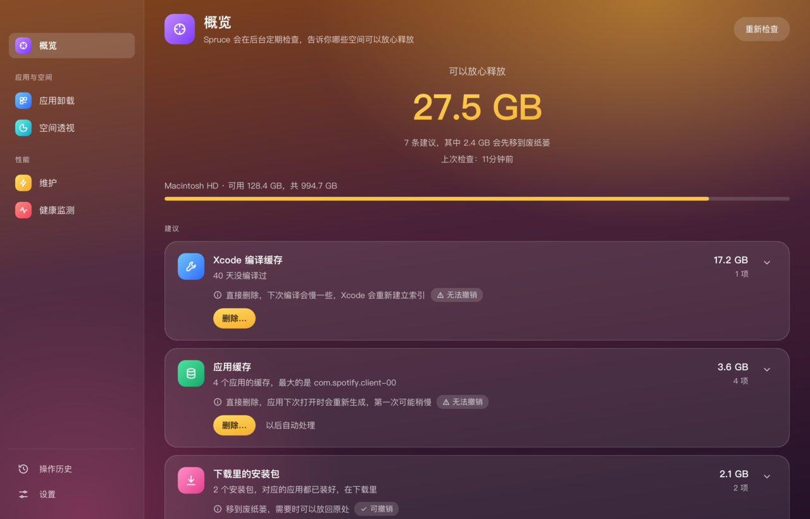
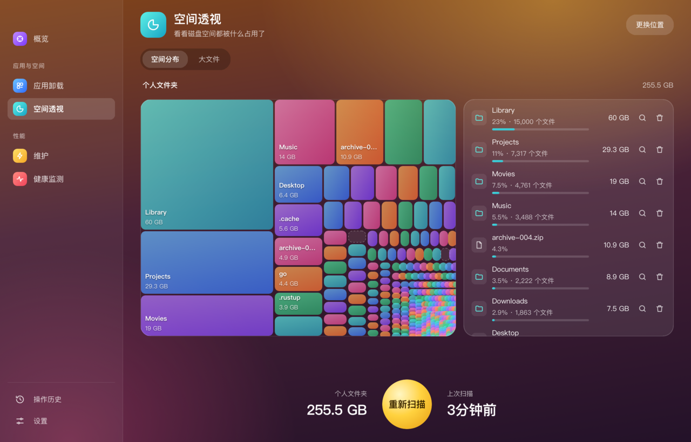
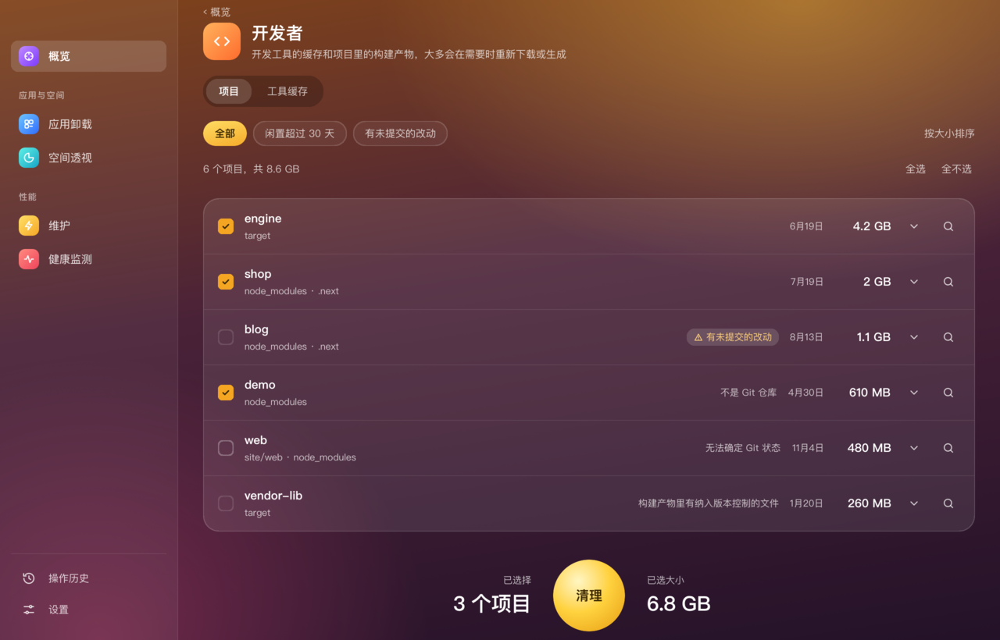
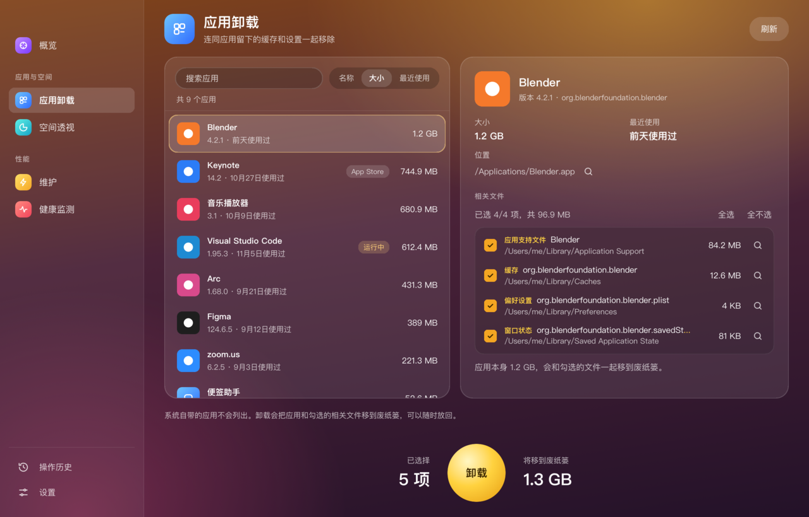
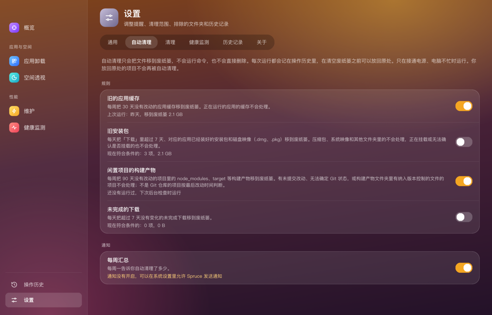
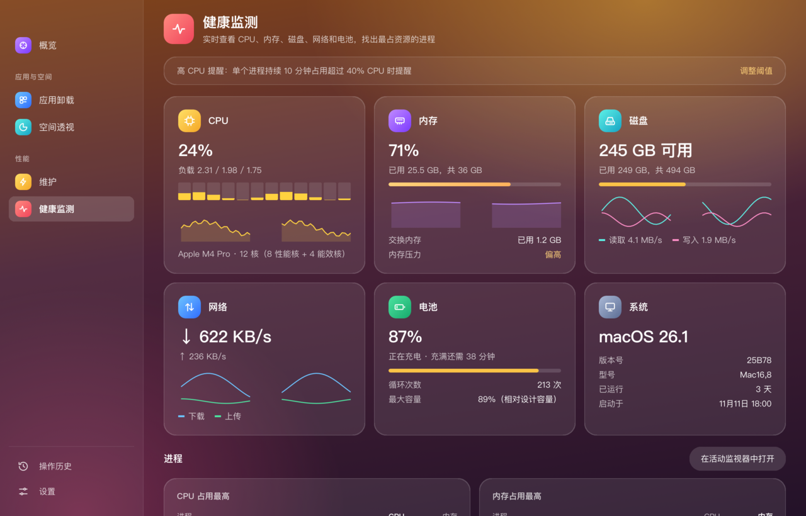

# Spruce

[](https://github.com/yldm-tech/spruce/actions/workflows/ci.yml)
[](https://github.com/yldm-tech/spruce/actions/workflows/release.yml)
[](https://github.com/yldm-tech/spruce/releases)
[](LICENSE)
[](#지원-플랫폼)

[English](README.md) · [简体中文](README.zh-CN.md) · [日本語](README.ja.md) · [繁體中文](README.zh-TW.md) · 한국어

Spruce는 macOS와 Windows용 디스크 정리 앱입니다. 백그라운드에서 디스크를 확인해 두기 때문에, 열었을 때 이미 안심하고 확보할 수 있는 공간, 지울 항목과 그 이유, 되돌릴 수 있는지를 알고 있습니다. 앱 제거, 디스크를 차지하는 것과 그 증가 추이 보기, 유지 관리 작업, 시스템 상태 모니터링도 합니다. Go로 작성되었고 [NSGo](https://github.com/nsgo-dev/nsgo) 위에서 동작합니다. 웹사이트: [spruce.yldm.ai](https://spruce.yldm.ai/ko/).

인터페이스는 간체 중국어만 지원하므로 스크린샷도 중국어입니다. 아래에서는 앱에 표시되는 문구를 그대로 인용하고 뜻을 함께 적었습니다.



## 기능

- **개요(概览).** 스캔 버튼이 없습니다. Spruce는 창을 열 때와 백그라운드에서 읽기 전용 대상 세 가지(시스템 정크 「系统垃圾」, 개발자 「开发者」, 설치 파일 「安装包」)를 확인하고, 결론(「可以放心释放 18.7 GB」, 안심하고 18.7 GB를 확보할 수 있음), 마지막 확인 시각, 다시 확인 버튼 「重新检查」를 바로 보여 줍니다. 지난 결과는 다음 실행 때 먼저 표시되고 그동안 새 확인이 진행되지만, 캐시된 결과를 기준으로 정리하는 일은 없습니다.
- **체크박스 대신 추천.** 각 카드는 이유와 결과가 적힌 하나의 작업입니다. 예를 들어 Xcode 빌드 캐시, 오래 손대지 않은 프로젝트의 빌드 결과물, 다운로드 폴더의 설치 파일 등이 크기와 안전도 순으로 정렬되고, 버튼은 하나이며 항목은 펼침 영역에 들어 있습니다. 카드마다 휴지통으로 옮기는지(되돌릴 수 있음), 다시 생성되는 것을 삭제하는지, 도구 자체의 명령을 실행하는지가 적혀 있습니다. 실행 중인 앱의 캐시, 최근 설치 파일, 커밋하지 않은 변경이 있는 프로젝트처럼 판단이 필요한 항목은 「需要你判断」에 따로 집계되고 선택되지 않습니다.
- **실행 취소(macOS).** 휴지통으로 옮기기는 바로 실행되고 「已移到废纸篓 3.1 GB · 撤销」가 표시되며, 「撤销」를 누르면 되돌립니다. 작업 기록 「操作历史」에서는 지난 30일 동안 옮긴 것 중 아직 휴지통에 있는 항목을 「放回原处」(원래 위치로 되돌리기)로 복원할 수 있고, 원래 위치에 지금 있는 파일을 덮어쓰지 않습니다.
- **공간 렌즈(空间透视).** 아무 폴더나 각 항목이 차지하는 크기대로 그린 지도와 가장 큰 파일 목록을 보여 줍니다. 열기, Finder나 파일 탐색기에서 보기, 휴지통으로 옮기기를 할 수 있습니다. Spruce는 하루에 한 번 주요 위치(캐시, 다운로드, 데스크탑, 문서, 미디어 폴더, 휴지통, 개발자 캐시, 프로젝트 폴더)의 크기를 기록해 90일 동안 보관하고, 최근 24시간·7일·30일 동안 커진 곳을 보여 줍니다.
- **개발자용(开发者).** 프로젝트마다 마지막 작업 시각, 빌드 결과물(node_modules, target, .next 등. Node, Rust, Maven, Gradle, CocoaPods, SwiftPM, Python, .NET, Zig, Flutter 프로젝트 지원)의 크기, Git 상태를 보여 줍니다. 커밋하지 않은 변경이 있거나 빌드 결과물 안에 버전 관리되는 파일이 있는 프로젝트는 선택되지도 정리되지도 않으며, 삭제 직전에 Git을 한 번 더 확인합니다. Git이 없거나 실패하면 「无法确定」(확인할 수 없음)로 표시되고 선택되지 않습니다. 도구 캐시(Xcode, Homebrew, npm, pnpm, Yarn, Go, Cargo, Gradle, JetBrains 등)는 도구 자체의 정리 명령이 있으면 그 명령으로 정리합니다.
- **시스템 정크(系统垃圾).** 앱과 브라우저 캐시, 완료되지 않은 다운로드, 로그, 충돌 보고서, 임시 파일, Windows의 오류 보고서. 브라우저의 쿠키, 방문 기록, 로그인 정보는 건드리지 않으며, 실행 중인 앱과 브라우저의 캐시는 선택되지 않습니다.
- **앱 제거(应用卸载).** macOS에서는 앱과 체크한 잔여 파일(Application Support, Caches, Preferences, Containers, Saved State, LaunchAgents 등)을 휴지통으로 옮기며 되돌릴 수 있습니다. Apple 기본 앱은 목록에 없고 실행 중인 앱은 제거할 수 없습니다. Windows에서는 먼저 프로그램 자체의 제거 프로그램을 실행한 뒤, `%APPDATA%`와 `%LOCALAPPDATA%`에 남은 파일을 휴지통으로 옮길지 묻습니다. Microsoft Store 앱은 목록에 없습니다.
- **유지 관리(维护).** macOS: DNS 캐시 비우기, Spotlight 색인 확인, Quick Look 미리보기 새로 고침, 아이콘 캐시 재구축, '다음으로 열기' 복구, Safari·메일·메시지 데이터베이스 최적화(전체 디스크 접근 권한 필요). Windows: DNS 캐시 비우기, 아이콘 캐시 새로 고침, 썸네일 캐시 지우기, 오래된 '연결 프로그램' 항목 정리, Windows 검색 확인. DNS 캐시 비우기와 손상된 Spotlight 색인 재구축은 실행할 때마다 한 번 관리자 권한을 요청합니다.
- **상태 모니터(健康监测).** 코어별 CPU, 메모리와 메모리 압력, 디스크와 네트워크 처리량, 배터리, 시스템 정보, CPU와 메모리를 가장 많이 쓰는 프로세스, 그리고 한 프로세스가 오랫동안 CPU를 너무 많이 쓸 때의 배너. Spruce는 프로세스를 보여 주기만 하고 종료하지 않습니다.
- **자동 정리(自动清理, macOS).** 규칙 네 가지가 있으며 모두 처음에는 꺼져 있습니다: 오래된 앱 캐시(30일 동안 변경 없음, 매주), 다운로드에 있는 7일 지난 설치 파일 중 해당 앱이 설치된 것(매일), 90일 동안 작업이 없고 Git이 깨끗한 프로젝트의 빌드 결과물(매주), 7일 동안 변화 없는 완료되지 않은 다운로드(매일). 규칙은 백그라운드 확인 후에 실행되고, 항목을 휴지통으로 옮기기만 하며, 명령을 실행하지 않고, 되돌린 항목은 다시 건드리지 않습니다. 모든 실행은 작업 기록에 남고 되돌릴 수 있습니다. 주간 요약 「每周汇总」은 매주 월요일에 옵니다.
- **메뉴 막대와 저장 공간 부족 알림(macOS).** 메뉴 막대 아이콘이 남은 공간을 보여 주고, 공간이 부족하면 경고 아이콘으로 바뀝니다. 창을 닫아도 Spruce는 메뉴 막대에 남습니다. 알림(처음에는 꺼짐, 기준 20 GB)을 켜면 시동 디스크의 남은 공간이 설정값 아래로 떨어질 때 한 번 알리고, 5 GB가 더 줄어들어야 다시 알리며, 하루 최대 한 번입니다.
- **명령줄.** 같은 실행 파일이 명령도 받습니다. [명령줄](#명령줄)을 참고하세요.







## 안전

- **확인은 읽기만 합니다.** 백그라운드 확인은 삭제하지 않고, 명령을 실행하지 않으며, 권한을 요청하지 않습니다. 최대 6시간에 한 번(첫 번째는 실행 2분 후), 전원에 연결되어 있고 저전력 모드가 아니며 컴퓨터가 뜨겁거나 바쁘지 않을 때(CPU 40% 이하)만, 정리 중이 아닐 때만 실행됩니다. 접근할 때 권한을 묻는 폴더(데스크탑, 문서, 다운로드, iCloud Drive, 다른 볼륨)는 사용자가 시작한 확인에서 한 번 읽은 뒤에야 백그라운드에서 읽습니다. 백그라운드 확인은 「设置 → 通用 → 在后台定期检查」에서 끌 수 있습니다.
- **누르기 전에 표시합니다.** 영구 삭제, 도구 명령 실행, 휴지통 비우기는 항상 먼저 확인하며 되돌릴 수 없다는 것을 카드에 적어 둡니다.
- **직전에 한 번 더 확인합니다.** 모든 항목은 옮기거나 삭제하기 직전에 다시 확인합니다. 확인 후 바뀌었거나, 사용 중이거나, 새 변경이 생긴 프로젝트에 속한 항목은 건너뜁니다.
- **확인한 범위 밖은 건드리지 않습니다.** Spruce는 확인한 폴더 안의 항목만 다루고, 제외한 폴더와 패턴을 지키며, 심볼릭 링크를 따라 다른 곳으로 가지 않습니다. 시스템 폴더, 키체인, iCloud Drive와 클라우드 폴더, 메일과 메시지, `~/.ssh`, 문서, 데스크탑, 사진 폴더 안에서는 영구 삭제하지 않고 휴지통으로 옮기기만 할 수 있습니다.
- **스스로 하지 않습니다.** Spruce는 스스로 명령을 실행하거나, 영구 삭제하거나, 휴지통을 비우거나, 앱을 제거하거나, 복원하거나, 유지 관리를 하지 않습니다. 자동 규칙도 켰을 때 파일을 휴지통으로 옮기기만 합니다.
- **데이터는 내 컴퓨터에만.** 계정이 필요 없습니다. 설정, 기록, 크기 스냅샷은 Spruce의 데이터 폴더에 있고, 나만 읽을 수 있는 파일입니다([데이터 폴더](#데이터-폴더) 참고).



## 지원 플랫폼

Spruce는 macOS(Apple 실리콘과 Intel)와 Windows(x64와 arm64)를 지원합니다. Linux 버전은 없습니다.

Windows에서는 무인으로 동작하거나 되돌릴 수 있는 흐름을 보장할 수 없는 부분이 있어, macOS에 있는 기능 일부가 아직 없습니다:

- 트레이 아이콘이 없습니다. 창을 닫으면 Spruce가 종료되고, 로그인할 때는 평소처럼 창이 열립니다.
- 백그라운드 확인과 저장 공간 부족 알림은 Spruce가 열려 있는 동안만 동작합니다.
- 휴지통으로 옮기기 전에 먼저 확인하며, 「撤销」와 「放回原处」가 없습니다(휴지통에서 복원하세요). `spruce restore`도 없습니다.
- 자동 규칙과 주간 요약이 없습니다.

추천 카드, 분류별 보기, 프로젝트, 공간 변화, 명령줄은 macOS와 같습니다.

## 설치

최신 버전은 [GitHub Releases](https://github.com/yldm-tech/spruce/releases)나 [spruce.yldm.ai](https://spruce.yldm.ai/ko/)에서 내려받습니다. `<version>`은 릴리스 버전(예: `0.1.0`)입니다:

- macOS: Apple 실리콘은 `spruce-<version>-macos-arm64.dmg`, Intel은 `spruce-<version>-macos-x64.dmg`. 디스크 이미지를 열고 Spruce를 응용 프로그램 폴더로 끌어다 놓습니다. 디스크 이미지는 Developer ID로 서명되고 Apple의 공증을 받았습니다.
- Windows: 대부분의 PC는 `spruce-<version>-windows-x64-setup.exe`, Windows on Arm PC는 `spruce-<version>-windows-arm64-setup.exe`. 설치 프로그램을 실행하면 현재 사용자에게만 설치됩니다. 아직 코드 서명이 없어서 실행 전에 SmartScreen이 경고할 수 있습니다. '추가 정보'를 누른 뒤 '실행'을 누르세요.

또는 릴리스에 포함된 설치 스크립트를 실행하세요. 내 컴퓨터에 맞는 패키지를 내려받아 `.sha256`으로 검증한 뒤 설치합니다. macOS에서는 `/Applications`, 쓸 수 없으면 `~/Applications`에 설치합니다:

```sh
curl -fsSL https://github.com/yldm-tech/spruce/releases/latest/download/install.sh | sh
```

Windows에서는 PowerShell에서:

```powershell
irm https://github.com/yldm-tech/spruce/releases/latest/download/install.ps1 | iex
```

각 릴리스의 `checksums.txt`에 모든 파일의 SHA-256이 있습니다. Spruce는 스스로 업데이트하지 않습니다. 새 버전을 내려받거나 설치 스크립트를 다시 실행하세요.

macOS의 전체 디스크 접근 권한은 선택 사항입니다. Safari와 메일 데이터베이스 최적화, 휴지통 읽기, 일부 앱의 잔여 파일 찾기, 크기 스냅샷에 다른 앱의 컨테이너 포함하기에 필요하며, 백그라운드 확인에서 요청하는 일은 없습니다.



## 명령줄

실행 파일에 명령을 붙여 실행합니다. macOS에서는 `Spruce.app/Contents/MacOS/Spruce <command>`, Windows에서는 `Spruce.exe <command>`입니다. 파일을 삭제하거나 바꾸는 것은 `clean --yes`와 `restore --yes`뿐입니다. 도움말에서는 `spruce`라고 부릅니다. 그렇게 입력하려면 macOS에서는 PATH에 링크를 만들고(`ln -s /Applications/Spruce.app/Contents/MacOS/Spruce /usr/local/bin/spruce`), Windows에서는 PowerShell 프로필에 별칭을 추가합니다(`Set-Alias spruce "$env:LOCALAPPDATA\Programs\Spruce\Spruce.exe"`).

| 명령 | 하는 일 |
|---|---|
| `scan [--source system-junk\|dev-junk\|installers]... [--json]` | 확인하고 분류별 크기와 항목 수를 보여 줍니다. |
| `recommendations [--json]`(또는 `list`) | 확인하고 추천 카드를 보여 줍니다: ID, 제목, 크기, 작업, 이유. |
| `clean [<recommendation-id>...] [--category <source:category>]... [--source <id>]... [--older-than 12h\|30d\|2w] [--yes \| --dry-run] [--json]` | 확인하고 선택한 뒤 계획을 출력합니다. `--yes`가 있을 때만 삭제합니다. ID가 없으면 명령을 실행하지 않는 추천을 모두 대상으로 하고, 명령은 이름을 지정한 추천에서만 실행합니다. 앱과 같은 확인을 거치고 작업 기록에 남습니다. |
| `projects [--json]` | 프로젝트 폴더를 확인하고 프로젝트, 빌드 결과물, Git 상태를 보여 줍니다. |
| `history [--limit 20] [--json]` | 최근 기록과 되돌릴 수 있는지를 보여 줍니다. |
| `restore <run-id> [--yes] [--json]` | macOS 전용: 기록이 휴지통으로 옮긴 것 중 아직 되돌릴 수 있는 것을 보여 주고, `--yes`가 있을 때만 되돌립니다. |
| `help [<command>]`, `version` | 도움말과 버전. |

`--json`(`help`를 뺀 모든 명령에서 사용 가능)을 붙이면 표준 출력은 JSON 객체 하나(`{"version":1,"command":...}` 또는 `{"version":1,"error":...}`)가 되고, 로그는 표준 오류로 나갑니다. 종료 코드: 0 성공(할 일이 없는 경우와 시험 실행 포함), 1 실패, 2 사용법 오류, 3 일부만 완료(실패하거나 보류된 항목 있음), 4 사용 중(앱이나 다른 명령이 정리 중), 130 중단됨.

앱과 명령줄은 데이터 폴더의 잠금을 함께 쓰므로 동시에 정리하지 않습니다. 터미널을 닫거나 SSH 연결이 끊기면 Ctrl+C처럼 현재 항목을 마친 뒤 정리를 멈추고, 그것도 기록됩니다. 명령줄은 root로 실행되지 않습니다. `sudo`에서는 앱이 열 수 없는 파일을 데이터 폴더에 쓰게 되고, 옮긴 파일도 내 휴지통에 들어가지 않기 때문입니다.

macOS에서 명령줄의 개인 정보 보호 권한은 Spruce.app이 아니라 그것을 실행하는 터미널 앱의 것입니다. 터미널에서 빠짐없이 확인하려면 시스템 설정에서 그 터미널에 전체 디스크 접근 권한을 주세요.

Windows에서는 실행 파일이 GUI 프로그램이라 `cmd.exe`가 끝나기를 기다리지 않습니다. `start /wait Spruce.exe scan`을 쓰거나, PowerShell에서 `[Console]::OutputEncoding = [Text.UTF8Encoding]::new(); .\Spruce.exe scan | Out-Host`를 쓰세요. 출력은 UTF-8이므로 다른 파이프나 리디렉션 전에도 같은 방식으로 `[Console]::OutputEncoding`을 설정해야 중국어와 JSON 문자열이 깨지지 않습니다.

## 데이터 폴더

Spruce의 데이터는 macOS에서는 `~/Library/Application Support/Spruce`, Windows에서는 `%AppData%\Spruce`에 있습니다. 파일은 0600, 폴더는 0700이며, 원자적으로 교체하거나 한 줄씩 덧붙이므로 충돌이 나도 반쯤 쓰인 파일이 남지 않습니다. 손상된 파일이나 다른 버전의 파일은 무시되고 다음 저장 때 교체됩니다.

| 파일 | 내용 | 한도 |
|---|---|---|
| `settings.json` | 설정 | |
| `history.jsonl` | 작업 기록, 실행마다 JSON 한 줄 | 500회 |
| `overview-cache.json` | 마지막 확인 결과. 표시 전용이며 삭제에는 쓰지 않음 | 8 MB, 7일 동안 표시 |
| `undo/` | 실행마다 휴지통으로 옮긴 것, 진행 중인 정리의 저널, 되돌린 항목(규칙이 다시 건드리지 않도록) | 200개, 32 MB, 30일 |
| `growth/` | 매일의 크기 스냅샷 | 40개 파일, 8 MB, 90일 |
| `background.json` | 각 자동 규칙의 마지막 실행 시각, 마지막 주간 요약, 저장 공간 부족 알림 상태 | 작음 |
| `folder-access.json` | 사용자가 시작한 확인에서 읽은, 권한을 묻는 폴더 | 작음 |
| `clean.lock` | 정리나 확인 중에 앱과 명령줄이 함께 쓰는 잠금 | |
| `instance.lock`, `instance.sock` | 단일 인스턴스 잠금, 그리고 두 번째 실행이 실행 중인 창을 앞으로 가져오는 소켓 | |
| `window.json`, `app-icons/` | 창 위치와 캐시된 앱 아이콘 | |

작업 기록의 「清空历史」(기록 지우기)는 실행 취소 기록(되돌린 항목 목록은 제외), 캐시된 결과, 스냅샷도 삭제합니다.

## 소스에서 빌드

Go 1.27.3 이상이 필요합니다:

```sh
git clone https://github.com/yldm-tech/spruce.git
cd spruce
make build
```

`make build`는 지금 플랫폼용으로 `go tool nsgo build`를 실행하고(`TARGET=`으로 다른 플랫폼, 예: `make build TARGET=windows_x64`), 앱은 `apps/spruce/build/`에, 배포할 파일은 `apps/spruce/build/releases/`에 씁니다. macOS에서는 임시 서명된 `Spruce.app`과 `.dmg`, Windows에서는 프로그램과, `makensis`가 설치되어 있으면 NSIS 설치 프로그램입니다. Windows 버전은 cgo가 필요 없어 어느 플랫폼에서나 크로스 빌드할 수 있습니다. `make`가 없으면(기본 Windows 등) 저장소 루트에서 `go tool nsgo build -target windows_x64 apps/spruce`를 실행하세요. `nsgo`는 앱의 Go 도구 의존성이라 `go tool nsgo`를 위해 따로 설치할 것이 없습니다.

## 개발

저장소 루트는 Go 워크스페이스(`go.work`)이고, 앱은 `apps/spruce`의 모듈입니다.

```sh
make test   # go test ./apps/spruce/...
make dev    # 앱을 실행하고, 바뀔 때마다 다시 빌드해 재시작
make build  # 지금 플랫폼용으로 apps/spruce/build에 빌드
make check  # CI가 실행하는 모든 검사(apps/spruce/scripts/check.sh)
```

`make check`는 gofmt, 두 아키텍처의 macOS와 Windows용 vet과 빌드, 경쟁 상태 검사를 켠 테스트, golangci-lint v2(`apps/spruce/go.mod`의 버전 이상인 Go로 빌드한 것), 헤드리스 nsgo 테스트, nsgo check를 실행합니다. 창 테스트는 고정된 테스트 데이터로 각 페이지를 주요 상태로 만들고, macOS에서 `go tool nsgo test -target macos apps/spruce`로 실제 창의 스크린샷을 찍습니다(일부 화면만 찍으려면 `-run 'TestScreensSpace'` 추가). 스크린샷은 `apps/spruce/.nsgo/test/screenshots/<target>`에 저장됩니다.

`nsgo dev`와 `nsgo test -target macos`는 앱을 임시 서명해 터미널에서 실행하므로, 앱의 신원에 의존하는 기능(전체 디스크 접근 권한, 로그인 항목, 관리자 권한이 필요한 유지 관리)은 `nsgo build`로 만든 번들에서 확인해야 합니다.

저장소 구조:

- `apps/spruce/main.go`, `wire.go`: 시작, 단일 인스턴스 확인, 엔진 조립.
- `apps/spruce/internal/engine/`: 스캔, 정리, 제거, 유지 관리, 기록, 설정, 시스템 정보. UI에 의존하지 않습니다.
- `apps/spruce/internal/app/`: 엔진과 페이지 사이에서 UI가 호출하는 컨트롤러.
- `apps/spruce/internal/cli/`: 명령줄.
- `apps/spruce/internal/host/`: 데이터 폴더, 단일 인스턴스, 로그인 항목, 전체 디스크 접근 권한, 백그라운드 읽기 제한.
- `apps/spruce/internal/ui/`: 셸(창, 메뉴 막대, 알림), 각 페이지, 디자인 시스템(`kit`), 앱 전체의 스토어.
- `docs/assets/`: README와 웹사이트가 함께 쓰는 아이콘과 스크린샷.

## CI와 릴리스

[CI](https://github.com/yldm-tech/spruce/actions/workflows/ci.yml) 워크플로는 GitHub 호스팅 러너에서 풀 리퀘스트와 `main`을 검사합니다. [Release](https://github.com/yldm-tech/spruce/actions/workflows/release.yml) 워크플로는 `main`의 CI가 통과한 뒤 실행되며, 마지막 태그 이후의 Conventional Commits로 다음 버전을 정하고(범위가 `site`나 `deps`인 변경은 릴리스하지 않음), 버전을 [변경 기록](apps/spruce/CHANGELOG.md)의 해당 섹션과 함께 `chore(release)`로 `main`에 커밋해 태그를 붙인 뒤, 서명·공증된 macOS 디스크 이미지와 Windows 설치 프로그램을 빌드하고, 패키지, 체크섬, 빌드 출처 증명과 함께 GitHub 릴리스를 게시합니다.

## 라이선스

[MIT](LICENSE). 함께 들어 있는 Inter 글꼴은 SIL Open Font License 1.1입니다([apps/spruce/resources/fonts/Inter-LICENSE.txt](apps/spruce/resources/fonts/Inter-LICENSE.txt)). 서드파티 라이브러리와 라이선스는 앱의 「设置 → 关于 → 开源许可」에 나와 있습니다.
