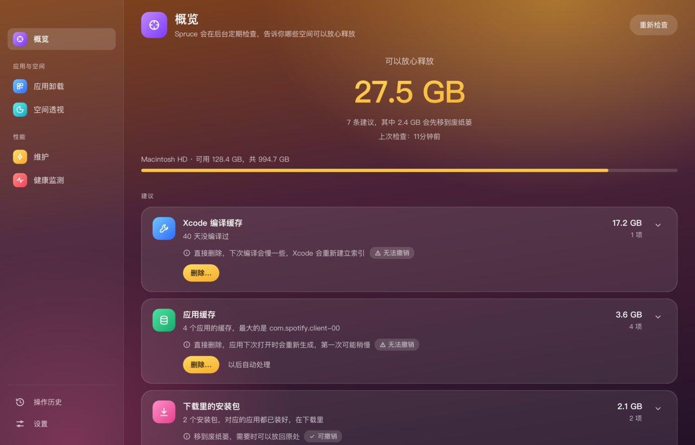
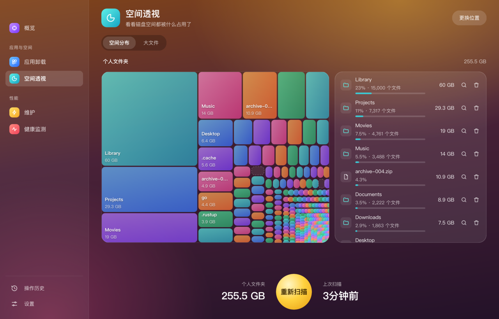
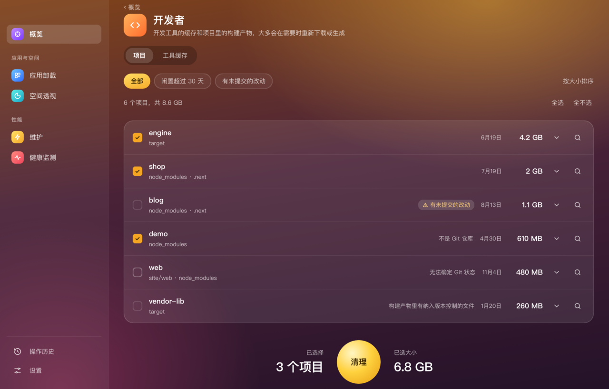
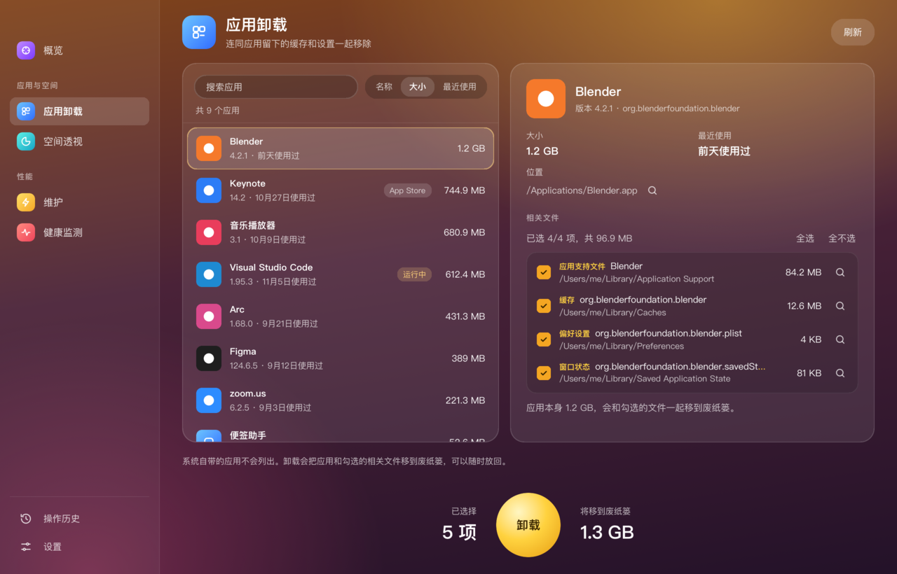
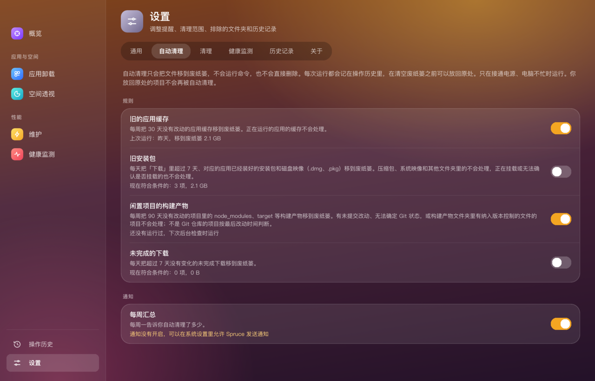
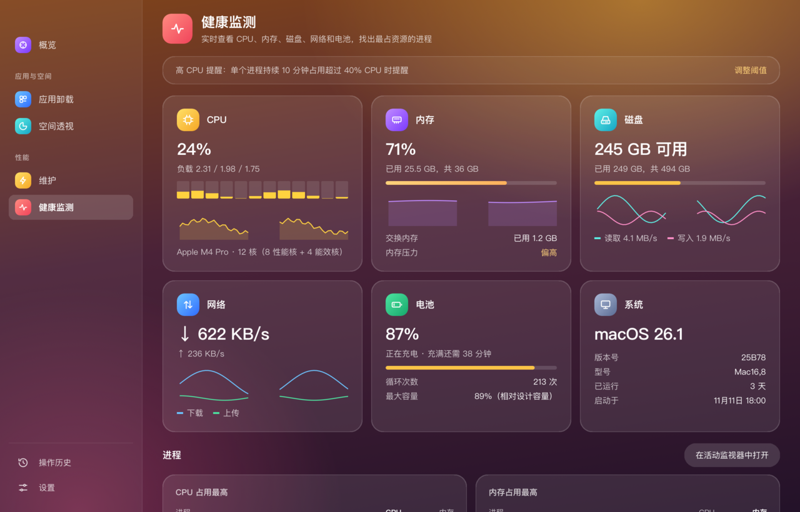

# Spruce

[](https://github.com/yldm-tech/spruce/actions/workflows/ci.yml)
[](https://github.com/yldm-tech/spruce/actions/workflows/release.yml)
[](https://github.com/yldm-tech/spruce/releases)
[](LICENSE)
[](#platforms)

English · [简体中文](README.zh-CN.md) · [日本語](README.ja.md) · [繁體中文](README.zh-TW.md) · [한국어](README.ko.md)

Spruce is a desktop disk cleaner for macOS and Windows. It checks your disk in the background, and when you open it, it already knows how much space you can safely free, which items it would remove, why, and whether that can be undone. It also uninstalls apps, shows what fills the disk and how it grows, runs maintenance tasks and watches the system's health. It is written in Go on [NSGo](https://github.com/nsgo-dev/nsgo). Website: [spruce.yldm.ai](https://spruce.yldm.ai).

The interface is in Simplified Chinese only, so every screenshot shows Chinese text; the labels quoted below are the app's own, with their meaning.



## What it does

- **Overview (概览).** There is no scan button. Spruce checks three read-only sources, system junk (系统垃圾), developer files (开发者) and installers (安装包), when the window opens and in the background, and shows how much you can safely free (「可以放心释放 18.7 GB」), when it last checked, and 重新检查 to check again. The last result is shown at the next launch while a fresh check runs, but nothing is ever cleaned from a cached result.
- **Recommendations, not checkboxes.** Each card is one action with a reason and a consequence, such as the Xcode build cache, build output of idle projects or installers in Downloads, sorted by size and safety, with one button and the items behind an expander. Each card says whether it moves to the Trash (can be undone), deletes something that is regenerated, or runs a tool's own command. Items that need your judgement, such as caches of running apps, recent installers and projects with uncommitted changes, are counted apart under 需要你判断 and not selected.
- **Undo (macOS).** A move to the Trash happens at once and shows 「已移到废纸篓 3.1 GB · 撤销」; 撤销 puts the items back. Operation history (操作历史) offers 放回原处 (put back) for moves of the last 30 days that are still in the Trash, and never overwrites an item that took the old place.
- **Space Lens (空间透视).** A map of any folder, sized by what each item takes, and a list of the largest files; open an item, reveal it in Finder or Explorer, or move it to the Trash. Once a day Spruce records the size of the main locations (caches, Downloads, Desktop, Documents, media folders, the Trash, developer caches, project folders), keeps 90 days, and shows what grew over 24 hours, 7 days or 30 days.
- **For developers (开发者).** Projects are listed with their last activity, the size of their build output (node_modules, target, .next and others, for Node, Rust, Maven, Gradle, CocoaPods, SwiftPM, Python, .NET, Zig and Flutter projects) and their Git state. A project with uncommitted changes, or with tracked files inside its build output, is never selected or cleaned, and Git is asked again right before anything is deleted; when Git is missing or fails, the project is marked 无法确定 (unknown) and not selected. Tool caches (Xcode, Homebrew, npm, pnpm, Yarn, Go, Cargo, Gradle, JetBrains and more) are cleaned with the tool's own command where it has one.
- **System junk (系统垃圾).** App and browser caches, unfinished downloads, logs, crash reports, temporary files, and error reports on Windows. Browser cookies, history and logins are not touched, and caches of running apps and browsers are not selected.
- **Uninstall (应用卸载).** On macOS, the app and the leftovers you tick (Application Support, Caches, Preferences, Containers, Saved State, LaunchAgents and more) go to the Trash and can be put back; Apple's own apps are not listed and a running app cannot be removed. On Windows, Spruce runs the program's own uninstaller, then offers what it left in `%APPDATA%` and `%LOCALAPPDATA%` for the Recycle Bin; Store apps are not listed.
- **Maintenance (维护).** On macOS: flush the DNS cache, check the Spotlight index, refresh Quick Look previews, rebuild icon caches, repair "Open With", optimize the Safari, Mail and Messages databases (with Full Disk Access). On Windows: flush the DNS cache, refresh the icon cache, clear the thumbnail cache, clean stale "Open With" entries, check Windows Search. Flushing DNS, and rebuilding a broken Spotlight index, ask for administrator rights once per run.
- **Health (健康监测).** CPU per core, memory and pressure, disk and network throughput, battery, system information, the processes using the most CPU and memory, and a banner when one process uses too much CPU for too long. Spruce only shows processes; it never ends them.
- **Automatic cleaning (自动清理, macOS).** Four rules, all off until you turn them on: old app caches (unchanged for 30 days, weekly), installers in Downloads older than 7 days whose app is installed (daily), build output of projects idle for 90 days and clean in Git (weekly), and unfinished downloads unchanged for 7 days (daily). Rules run after a background check, only move items to the Trash, never run a command, never take an item you put back, and every run is recorded in 操作历史 and can be put back. A weekly summary (每周汇总) arrives on Mondays.
- **Menu bar and low-space alert (macOS).** A menu bar icon shows free space and switches to an alert icon when space runs low; closing the window keeps Spruce there. An optional notification (off by default, 20 GB unless you set another level) says once when the startup disk drops below your level, again only after a further 5 GB, and at most once a day.
- **Command line.** The same executable takes commands; see [Command line](#command-line).







## Safety

- **Checks only read.** Background checks never delete, never run commands and never ask for a permission. They run at most every 6 hours (the first 2 minutes after launch), only on power, not in Low Power Mode, and not when the computer is hot or busy (over 40 % CPU), and never while a clean runs. Folders that prompt for access (Desktop, Documents, Downloads, iCloud Drive, other volumes) are read in the background only after a check you started has read them. 设置 → 通用 → 在后台定期检查 turns background checks off.
- **Labeled before you press.** Deleting for good, running a tool's command and emptying the Trash always ask first and cannot be undone, and their cards say so.
- **Checked again at the last moment.** Every item is checked again right before it is moved or deleted; one that changed since the check, is in use, or belongs to a project with new changes is skipped.
- **Stays inside what it checked.** Spruce only removes items inside the folders it checked, honors the folders and patterns you exclude, and never follows a symbolic link elsewhere. It never deletes for good inside the system's folders, keychains, iCloud Drive and cloud folders, Mail and Messages, `~/.ssh`, Documents, Desktop or Pictures: there it can only use the Trash.
- **Never on its own.** Spruce never runs commands, deletes for good, empties the Trash, uninstalls, restores or runs maintenance by itself. Automatic rules, once you turn them on, only move files to the Trash.
- **Stays on your computer.** There is no account. Settings, history and size snapshots stay in Spruce's data folder, in files only you can read (see [Data folder](#data-folder)).



## Platforms

Spruce is built for macOS (Apple silicon and Intel) and Windows (x64 and arm64). There is no Linux build.

Windows does not have everything macOS has yet, where an unattended or reversible flow cannot be guaranteed there:

- no tray icon: closing the window quits Spruce, and at login the window opens as usual;
- background checks and the low-space notification run only while Spruce is open;
- moves to the Recycle Bin are confirmed first and have no 撤销 or 放回原处 (restore them from the Recycle Bin), and `spruce restore` is not available;
- no automatic rules or weekly summary.

Recommendation cards, the drill-down views, projects, growth over time and the command line work as on macOS.

## Install

Download the latest release from [GitHub Releases](https://github.com/yldm-tech/spruce/releases) or [spruce.yldm.ai](https://spruce.yldm.ai). Pick the file for your system, where `<version>` is the release's version, such as `0.1.0`:

- macOS: `spruce-<version>-macos-arm64.dmg` for Apple silicon, `spruce-<version>-macos-x64.dmg` for Intel. Open the disk image and drag Spruce to Applications. The disk images are signed with a Developer ID and notarized by Apple.
- Windows: `spruce-<version>-windows-x64-setup.exe` for most PCs, `spruce-<version>-windows-arm64-setup.exe` for a Windows on Arm PC. Run the installer; it installs for your user only. It is not code-signed yet, so SmartScreen may warn before it runs: choose More info, then Run anyway.

Or run the release's install script, which downloads the package for your machine, checks it against its `.sha256` and installs it. On macOS it installs the app into `/Applications`, or `~/Applications` when it cannot write there:

```sh
curl -fsSL https://github.com/yldm-tech/spruce/releases/latest/download/install.sh | sh
```

On Windows, in PowerShell:

```powershell
irm https://github.com/yldm-tech/spruce/releases/latest/download/install.ps1 | iex
```

`checksums.txt` in each release lists the SHA-256 of every file. Spruce does not update itself: download the new version, or run the install script again.

Full Disk Access is optional on macOS. Spruce needs it to optimize the Safari and Mail databases, read the Trash, find some apps' leftovers and include other apps' containers in the size snapshots, and it never asks for it from a background check.



## Command line

Run the executable with a command: `Spruce.app/Contents/MacOS/Spruce <command>` on macOS, `Spruce.exe <command>` on Windows. Nothing but `clean --yes` and `restore --yes` deletes or changes your files. The help calls it `spruce`; to type it that way, link it into your PATH on macOS (`ln -s /Applications/Spruce.app/Contents/MacOS/Spruce /usr/local/bin/spruce`) or add an alias on Windows (`Set-Alias spruce "$env:LOCALAPPDATA\Programs\Spruce\Spruce.exe"` in your PowerShell profile).

| Command | What it does |
|---|---|
| `scan [--source system-junk\|dev-junk\|installers]... [--json]` | Checks and lists the categories with sizes and item counts. |
| `recommendations [--json]` (or `list`) | Checks and lists the recommendation cards: ID, title, size, action and reason. |
| `clean [<recommendation-id>...] [--category <source:category>]... [--source <id>]... [--older-than 12h\|30d\|2w] [--yes \| --dry-run] [--json]` | Checks, selects and prints the plan; deletes only with `--yes`. Without IDs it takes every recommendation that runs no command; a command runs only when its recommendation is named. It goes through the same checks as the app and is recorded in 操作历史. |
| `projects [--json]` | Checks the project folders and lists the projects with their build output and Git state. |
| `history [--limit 20] [--json]` | Lists recent records and whether they can be put back. |
| `restore <run-id> [--yes] [--json]` | macOS only: lists what a record moved to the Trash that can still go back; puts it back only with `--yes`. |
| `help [<command>]`, `version` | Help and version. |

With `--json` (every command but `help`), standard output is one JSON object (`{"version":1,"command":...}`, or `{"version":1,"error":...}`); logs go to standard error. Exit codes: 0 success (including nothing to do and dry runs), 1 failure, 2 usage error, 3 partly done (some items failed or were held), 4 busy (Spruce is cleaning, in the app or another command), 130 interrupted.

The app and the command line share a lock in the data folder, so they never clean at the same time. Closing the terminal or losing the SSH session stops a clean after its current item, like Ctrl+C, and it is still recorded. The command line refuses to run as root: under `sudo` it would write files into your data folder that the app can no longer open, and its moves would not reach your Trash.

On macOS the privacy permissions of the command line belong to the terminal app that runs it, not to Spruce.app: for a complete check from a terminal, give that terminal Full Disk Access in System Settings.

On Windows the executable is a GUI program, so `cmd.exe` does not wait for it: use `start /wait Spruce.exe scan`, or from PowerShell `[Console]::OutputEncoding = [Text.UTF8Encoding]::new(); .\Spruce.exe scan | Out-Host`. The output is UTF-8, so set `[Console]::OutputEncoding` the same way before any other pipe or redirect, or the Chinese text and the JSON strings come out garbled.

## Data folder

Spruce keeps its data in `~/Library/Application Support/Spruce` on macOS and `%AppData%\Spruce` on Windows. Files are 0600 in 0700 folders, and are replaced atomically or appended line by line, so a crash leaves no half-written file behind. A damaged file, or one of another version, is ignored and replaced on the next save.

| File | What it holds | Limit |
|---|---|---|
| `settings.json` | Settings | |
| `history.jsonl` | 操作历史, one JSON line per run | 500 runs |
| `overview-cache.json` | The last check result, for display only (never used to delete) | 8 MB, shown for 7 days |
| `undo/` | What each run moved to the Trash, the journal of a clean in progress, and the items put back (so rules leave them alone) | 200 entries, 32 MB, 30 days |
| `growth/` | Daily size snapshots | 40 files, 8 MB, 90 days |
| `background.json` | When each automatic rule last ran, the last weekly summary, the low-space alert state | small |
| `folder-access.json` | The prompting folders a check you started has read | small |
| `clean.lock` | The lock the app and the command line share while cleaning or checking | |
| `instance.lock`, `instance.sock` | The single-instance lock and the socket a second launch uses to bring the running copy to the front | |
| `window.json`, `app-icons/` | The window frame and cached app icons | |

清空历史 (clear history) in 操作历史 also deletes the undo records (but not the list of items put back), the cached result and the snapshots.

## Build from source

With Go 1.27.3 or later:

```sh
git clone https://github.com/yldm-tech/spruce.git
cd spruce
make build
```

`make build` runs `go tool nsgo build` for the platform you are on (`TARGET=` builds others, such as `make build TARGET=windows_x64`) and writes the app under `apps/spruce/build/` and what to hand out under `apps/spruce/build/releases/`: on macOS an ad-hoc signed `Spruce.app` and a `.dmg`; for Windows the program, and its NSIS installer when `makensis` is installed. Windows builds need no cgo, so they cross-build from any platform. Without `make`, as on a stock Windows, run `go tool nsgo build -target windows_x64 apps/spruce` from the repository root. `nsgo` is a Go tool dependency of the app, so `go tool nsgo` needs nothing else installed.

## Development

The repository root is a Go workspace (`go.work`); the app is the module in `apps/spruce`.

```sh
make test   # go test ./apps/spruce/...
make dev    # run the app, rebuilding and restarting it on every change
make build  # build the app for this platform into apps/spruce/build
make check  # every check CI runs (apps/spruce/scripts/check.sh)
```

`make check` runs gofmt, vet and build for macOS and Windows on both architectures, the tests with the race detector, golangci-lint v2 (built with a Go at least as new as the one in `apps/spruce/go.mod`), the headless nsgo tests and nsgo check. The window tests put each page into its main states from fixture data and take screenshots in a real window on macOS with `go tool nsgo test -target macos apps/spruce` (add `-run 'TestScreensSpace'` for some screens); the screenshots go to `apps/spruce/.nsgo/test/screenshots/<target>`.

`nsgo dev` and `nsgo test -target macos` sign the app ad hoc and start it from the terminal, so anything that depends on the app's identity (Full Disk Access, the login item, elevated maintenance tasks) has to be checked in a bundle made by `nsgo build`.

Repository layout:

- `apps/spruce/main.go`, `wire.go`: start-up, the single-instance check and the engine wiring.
- `apps/spruce/internal/engine/`: scanning, cleaning, uninstalling, maintenance, history, settings and system information, with no UI dependency.
- `apps/spruce/internal/app/`: the controllers the UI calls, between the engine and the pages.
- `apps/spruce/internal/cli/`: the command line.
- `apps/spruce/internal/host/`: the data folder, single instance, login item, Full Disk Access and the background read gate.
- `apps/spruce/internal/ui/`: the shell (window, menu bar, notifications), the pages, the design system (`kit`) and the app-wide stores.
- `docs/assets/`: the icon and screenshots the READMEs and the website share.

## CI and releases

The [CI](https://github.com/yldm-tech/spruce/actions/workflows/ci.yml) workflow checks pull requests and `main` on GitHub-hosted runners. The [Release](https://github.com/yldm-tech/spruce/actions/workflows/release.yml) workflow runs after CI passes on `main`: it picks the next version from the Conventional Commits since the last tag (changes scoped `site` or `deps` release nothing), commits it to `main` as `chore(release)` with its section of [the changelog](apps/spruce/CHANGELOG.md), tags it, builds the signed and notarized macOS disk images and the Windows installers, and publishes a GitHub release with the packages, their checksums and build provenance attestations.

## License

[MIT](LICENSE). The bundled Inter fonts are under the SIL Open Font License 1.1 ([apps/spruce/resources/fonts/Inter-LICENSE.txt](apps/spruce/resources/fonts/Inter-LICENSE.txt)); the third-party libraries and their licenses are listed in the app under 设置 → 关于 → 开源许可.
