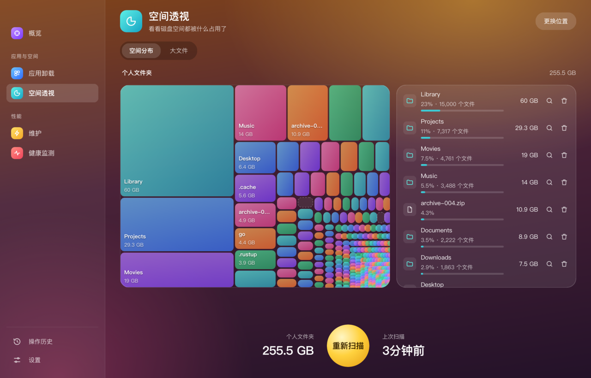
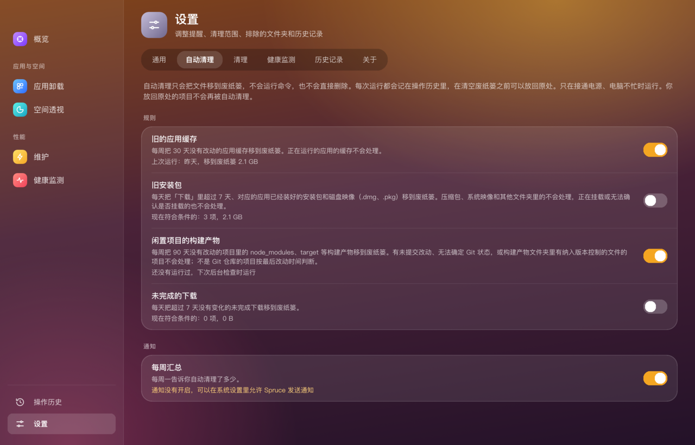
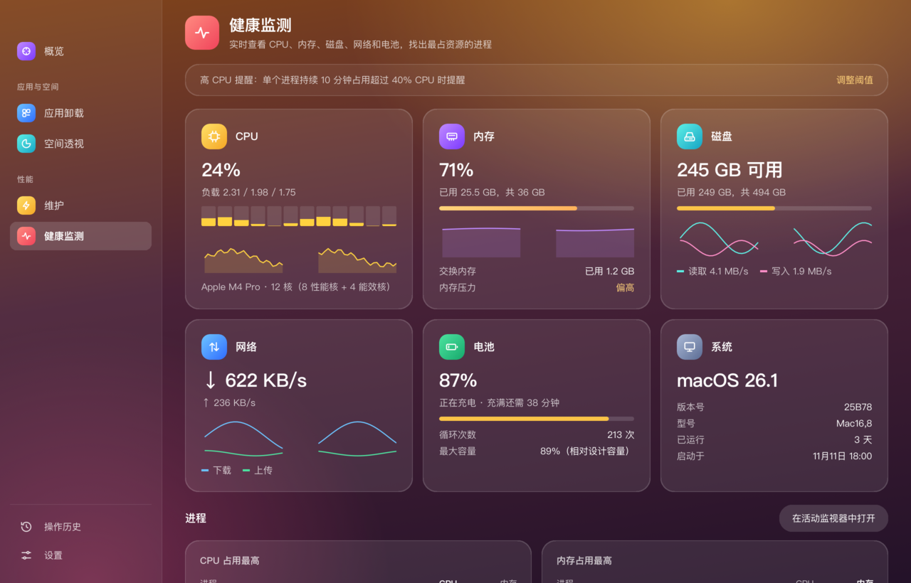

# Spruce

[](https://github.com/yldm-tech/spruce/actions/workflows/ci.yml)
[](https://github.com/yldm-tech/spruce/actions/workflows/release.yml)
[](https://github.com/yldm-tech/spruce/releases)
[](LICENSE)
[](#支持的平台)

[English](README.md) · 简体中文 · [日本語](README.ja.md) · [繁體中文](README.zh-TW.md) · [한국어](README.ko.md)

Spruce 是 macOS 和 Windows 上的磁盘清理工具。它在后台检查你的磁盘，打开它时就已经知道可以放心释放多少空间、会清理哪些项目、为什么，以及能不能撤销。它还能卸载应用、查看磁盘被什么占满以及如何增长、运行维护任务、监测系统健康。Spruce 用 Go 编写，基于 [NSGo](https://github.com/nsgo-dev/nsgo)。网站：[spruce.yldm.ai](https://spruce.yldm.ai/zh-CN/)。


## 功能

- **概览。** 没有扫描按钮。Spruce 在打开窗口时和后台检查三个只读来源（系统垃圾、开发者、安装包），直接告诉你结论（「可以放心释放 18.7 GB」）、上次检查的时间，以及「重新检查」。上次的结果会在下次启动时先显示出来，同时进行新的检查，但永远不会基于缓存的结果做清理。
- **给建议，而不是一长串复选框。** 每张卡片是一项具体操作，写明原因和后果，比如 Xcode 编译缓存、闲置项目的构建产物、下载里的安装包，按大小和安全程度排序，只有一个按钮，具体项目收在展开区域里。每张卡片都写明是移到废纸篓（可撤销）、删除会自动重新生成的文件，还是运行工具自带的命令。正在运行的应用的缓存、最近的安装包、有未提交改动的项目等需要你判断的项目会单独计入「需要你判断」，默认不选中。
- **撤销（macOS）。** 移到废纸篓会立即完成，并显示「已移到废纸篓 3.1 GB · 撤销」，点「撤销」即可放回。在「操作历史」里，30 天内、仍在废纸篓里的项目都可以「放回原处」，不会覆盖原位置上现有的文件。
- **空间透视。** 用一张图看清任意文件夹里各项占了多少空间，再列出最大的文件；可以打开、在访达或资源管理器中显示，或移到废纸篓。Spruce 每天记录一次主要位置（缓存、下载、桌面、文稿、媒体文件夹、废纸篓、开发者缓存、项目文件夹）的大小，保留 90 天，可以查看最近 24 小时、7 天或 30 天里哪些位置在变大。
- **开发者。** 列出每个项目的最后活动时间、构建产物（node_modules、target、.next 等，支持 Node、Rust、Maven、Gradle、CocoaPods、SwiftPM、Python、.NET、Zig 和 Flutter 项目）的大小和 Git 状态。有未提交改动、或构建产物里有纳入版本控制的文件的项目永远不会被选中或清理，删除前还会再查一次 Git；没有 Git 或 Git 出错时标为「无法确定」，不会选中。工具缓存（Xcode、Homebrew、npm、pnpm、Yarn、Go、Cargo、Gradle、JetBrains 等）有自带清理命令的就用它的命令。
- **系统垃圾。** 应用和浏览器缓存、未完成的下载、日志、崩溃报告、临时文件，以及 Windows 上的错误报告。不包括浏览器的 Cookie、历史记录和登录信息；正在运行的应用和浏览器的缓存不会选中。
- **应用卸载。** 在 macOS 上，应用本身和你勾选的残留文件（Application Support、Caches、Preferences、Containers、Saved State、LaunchAgents 等）会移到废纸篓，可以放回；不列出 Apple 自带的应用，正在运行的应用无法移除。在 Windows 上，Spruce 先运行程序自带的卸载程序，再列出它在 `%APPDATA%` 和 `%LOCALAPPDATA%` 里留下的文件，可以移到回收站；不列出应用商店的应用。
- **维护。** macOS：刷新 DNS 缓存、校验 Spotlight 索引、刷新 QuickLook 预览、重建图标缓存、修复「打开方式」、优化 Safari、邮件和信息的数据库（需要完全磁盘访问权限）。Windows：刷新 DNS 缓存、刷新图标缓存、清除缩略图缓存、清理失效的「打开方式」、检查 Windows 搜索。在 macOS 上，刷新 DNS 缓存和重建出错的 Spotlight 索引需要管理员权限，每次运行只问一次；在 Windows 上，只有检查 Windows 搜索时才会请求管理员权限，而且只在该服务被设为自动启动却已停止时才请求。
- **健康监测。** 每个核心的 CPU、内存和内存压力、磁盘和网络读写速度、电池、系统信息、占用 CPU 和内存最多的进程；单个进程长时间占用过多 CPU 时显示提醒。Spruce 只显示进程，不会结束进程。
- **自动清理（macOS）。** 四条规则，默认都关闭：旧的应用缓存（30 天没有改动，每周）、「下载」里超过 7 天且对应应用已装好的安装包（每天）、闲置 90 天且 Git 干净的项目的构建产物（每周）、7 天没有变化的未完成下载（每天）。规则在后台检查之后运行，只会把文件移到废纸篓，不运行命令，不会再处理你放回原处的项目，每次运行都记在「操作历史」里，可以放回原处。「每周汇总」在每周一发送。
- **菜单栏和空间不足提醒（macOS）。** 菜单栏图标显示可用空间，空间不足时图标会变化；关闭窗口后 Spruce 继续留在菜单栏。可以开启提醒（默认关闭，阈值默认 20 GB）：启动磁盘的可用空间低于你设定的值时提醒一次，再少 5 GB 才会再次提醒，每天最多一次。
- **命令行。** 同一个可执行文件也接受命令，见[命令行](#命令行)。




## 安全

- **检查只读取。** 后台检查不会删除文件、不会运行命令，也不会弹出权限请求。最多每 6 小时一次（启动 2 分钟后第一次），只在接通电源、未开启低电量模式、电脑不热也不忙（CPU 不超过 40%）时进行，清理进行中不会检查。会弹出权限请求的文件夹（桌面、文稿、下载、iCloud 云盘、其他磁盘）只有在你手动发起的检查读过之后，后台才会读取。可以在「设置 → 通用 → 在后台定期检查」里关闭后台检查。
- **按下之前就标清楚。** 直接删除、运行工具命令和清空废纸篓一定会先确认，而且无法撤销，卡片上会写明。
- **动手前再查一次。** 每个项目在移走或删除前都会重新检查；检查之后有变化、正在使用，或所在项目有了新改动的，都会跳过。
- **不碰检查范围以外的东西。** Spruce 只处理检查过的文件夹里的项目，遵守你设置的排除文件夹和规则，不会顺着符号链接跑到别处。系统文件夹、钥匙串、iCloud 云盘和其他云盘文件夹、邮件和信息、`~/.ssh`、文稿、桌面和图片里的东西永远不会被直接删除，只能移到废纸篓。
- **不会自己动手。** Spruce 不会自己运行命令、直接删除、清空废纸篓、卸载应用、放回文件或做维护。你开启的自动规则也只会把文件移到废纸篓。
- **数据只留在你的电脑上。** 不需要账号。设置、历史记录和空间快照都保存在 Spruce 的数据文件夹里，只有你能读取（见[数据文件夹](#数据文件夹)）。



## 支持的平台

Spruce 支持 macOS（Apple 芯片和 Intel）和 Windows（x64 和 arm64），没有 Linux 版。

在 Windows 上无法保证无人值守或可撤销的流程，所以 Windows 版暂时缺少一些 macOS 版的功能：

- 没有托盘图标：关闭窗口即退出 Spruce，登录时照常打开窗口；
- 后台检查和空间不足提醒只在 Spruce 打开期间进行；
- 移到回收站前会先确认，没有「撤销」和「放回原处」（请从回收站还原），也没有 `spruce restore`；
- 没有自动清理规则和每周汇总。

建议卡片、分类查看、项目、空间变化和命令行与 macOS 版相同。

## 安装

从 [GitHub Releases](https://github.com/yldm-tech/spruce/releases) 或 [spruce.yldm.ai](https://spruce.yldm.ai/zh-CN/) 下载最新版本。按你的系统选择文件，其中 `<version>` 是版本号，例如 `0.1.0`：

- macOS：Apple 芯片选 `spruce-<version>-macos-arm64.dmg`，Intel 选 `spruce-<version>-macos-x64.dmg`。打开磁盘映像，把 Spruce 拖到「应用程序」。磁盘映像已用 Developer ID 签名并经过 Apple 公证。
- Windows：大多数电脑选 `spruce-<version>-windows-x64-setup.exe`，Windows on Arm 电脑选 `spruce-<version>-windows-arm64-setup.exe`。运行安装程序即可，只为当前用户安装。安装程序暂时没有代码签名，SmartScreen 可能会在运行前提示风险：点「更多信息」，再点「仍要运行」。

也可以运行版本附带的安装脚本：它会下载适合你电脑的安装包，用 `.sha256` 校验后安装。在 macOS 上会把应用装到 `/Applications`，没有写入权限时装到 `~/Applications`：

```sh
curl -fsSL https://github.com/yldm-tech/spruce/releases/latest/download/install.sh | sh
```

在 Windows 上，在 PowerShell 里运行：

```powershell
irm https://github.com/yldm-tech/spruce/releases/latest/download/install.ps1 | iex
```

每个版本的 `checksums.txt` 列出所有文件的 SHA-256。Spruce 不会自动更新：下载新版本，或再次运行安装脚本即可。

在 macOS 上，完全磁盘访问权限是可选的。优化 Safari、邮件和信息的数据库、读取废纸篓、查找部分应用的残留文件、在空间快照里计入其他应用的容器时需要它；后台检查从不请求这项权限。



## 命令行

带上命令运行可执行文件：macOS 上是 `Spruce.app/Contents/MacOS/Spruce <命令>`，Windows 上是 `Spruce.exe <命令>`。只有 `clean --yes` 和 `restore --yes` 会删除或改动你的文件。帮助里把它称为 `spruce`；想这样输入的话，在 macOS 上把它链接到 PATH 里（`ln -s /Applications/Spruce.app/Contents/MacOS/Spruce /usr/local/bin/spruce`），在 Windows 上添加别名（在 PowerShell 配置文件里写 `Set-Alias spruce "$env:LOCALAPPDATA\Programs\Spruce\Spruce.exe"`）。

| 命令 | 作用 |
|---|---|
| `scan [--source system-junk\|dev-junk\|installers]... [--json]` | 检查并列出各类别的大小和项目数。 |
| `recommendations [--json]`（或 `list`） | 检查并列出建议卡片：ID、标题、大小、操作和原因。 |
| `clean [<recommendation-id>...] [--category <source:category>]... [--source <id>]... [--older-than 12h\|30d\|2w] [--yes \| --dry-run] [--json]` | 检查、选择并打印计划；只有加上 `--yes` 才会删除。不指定 ID 时，选择所有不运行命令的建议；只有点名的建议才会运行命令。它经过与应用相同的检查，并记入「操作历史」。 |
| `projects [--json]` | 检查项目文件夹，列出项目、构建产物和 Git 状态。 |
| `history [--limit 20] [--json]` | 列出最近的记录，以及能否放回原处。 |
| `restore <run-id> [--yes] [--json]` | 仅限 macOS：列出一条记录移到废纸篓、还能放回的项目；只有加上 `--yes` 才会放回。 |
| `help [<command>]`、`version` | 帮助和版本。 |

加上 `--json`（`help` 以外的所有命令都支持）时，标准输出是一个 JSON 对象（`{"version":1,"command":...}` 或 `{"version":1,"error":...}`），日志写到标准错误。退出码：0 成功（包括没有可做的事和试运行），1 失败，2 用法错误，3 部分完成（有项目失败或被保留），4 忙（应用或另一个命令正在清理），130 被中断。

应用和命令行共用数据文件夹里的一把锁，所以不会同时清理。关闭终端或 SSH 断开会像 Ctrl+C 一样，在处理完当前项目后停止清理，并且照样记录。命令行拒绝以 root 身份运行：在 `sudo` 下，它写进数据文件夹的文件应用将无法打开，移走的文件也不会进入你的废纸篓。

在 macOS 上，命令行的隐私权限属于运行它的终端应用，而不是 Spruce.app：想在终端里完整检查，需要在「系统设置」里给这个终端完全磁盘访问权限。

在 Windows 上，可执行文件是图形界面程序，`cmd.exe` 不会等它结束：请用 `start /wait Spruce.exe scan`，或在 PowerShell 里用 `[Console]::OutputEncoding = [Text.UTF8Encoding]::new(); .\Spruce.exe scan | Out-Host`。输出是 UTF-8，所以在其他管道或重定向之前也要这样设置 `[Console]::OutputEncoding`，否则中文和 JSON 字符串会变成乱码。

## 数据文件夹

Spruce 的数据保存在 macOS 的 `~/Library/Application Support/Spruce` 和 Windows 的 `%AppData%\Spruce`。文件权限为 0600，文件夹为 0700；文件以原子方式替换或逐行追加，崩溃不会留下写了一半的文件。损坏的文件或其他版本的文件会被忽略，并在下次保存时替换。

| 文件 | 内容 | 上限 |
|---|---|---|
| `settings.json` | 设置 | |
| `history.jsonl` | 操作历史，每次运行一行 JSON | 500 次 |
| `overview-cache.json` | 上次检查的结果，只用于显示（从不用来删除） | 8 MB，显示 7 天 |
| `undo/` | 每次运行移到废纸篓的项目、进行中的清理的日志，以及已放回的项目（自动规则不会再处理它们） | 200 条、32 MB、30 天 |
| `growth/` | 每天的空间快照 | 40 个文件、8 MB、90 天 |
| `background.json` | 各条自动规则上次运行的时间、上次的每周汇总、空间不足提醒的状态 | 很小 |
| `folder-access.json` | 你手动发起的检查读过的、会弹出权限请求的文件夹 | 很小 |
| `clean.lock` | 应用和命令行在清理或检查时共用的锁 | |
| `instance.lock`、`instance.sock` | 单实例锁，以及再次启动时用来把已运行的窗口带到前面的套接字 | |
| `window.json`、`app-icons/` | 窗口位置和缓存的应用图标 | |

「操作历史」里的「清空历史」也会删除撤销记录（不包括已放回项目的列表）、缓存的结果和空间快照。

## 从源码构建

需要 Go 1.27.3 或更高版本：

```sh
git clone https://github.com/yldm-tech/spruce.git
cd spruce
make build
```

`make build` 为当前平台运行 `go tool nsgo build`（用 `TARGET=` 构建其他平台，例如 `make build TARGET=windows_x64`），应用写到 `apps/spruce/build/`，用于分发的文件写到 `apps/spruce/build/releases/`：macOS 上是临时签名的 `Spruce.app` 和 `.dmg`；Windows 上是程序本身，装有 `makensis` 时还有 NSIS 安装程序。Windows 版不需要 cgo，可以在任何平台交叉编译。没有 `make` 时（比如原装的 Windows），在仓库根目录运行 `go tool nsgo build -target windows_x64 apps/spruce`。`nsgo` 是应用的 Go 工具依赖，`go tool nsgo` 不需要另外安装任何东西。

## 开发

仓库根目录是一个 Go 工作区（`go.work`），应用是 `apps/spruce` 里的模块。

```sh
make test   # go test ./apps/spruce/...
make dev    # 运行应用，每次改动后重新构建并重启
make build  # 为当前平台构建应用，输出到 apps/spruce/build
make check  # CI 运行的全部检查（apps/spruce/scripts/check.sh）
```

`make check` 依次运行：gofmt，两种架构的 macOS 和 Windows 的 vet 和构建，检查 `apps/spruce/resources/THIRD_PARTY_NOTICES.txt` 与链接的模块一致，带竞态检测的测试，golangci-lint v2（需要用不低于 `apps/spruce/go.mod` 中版本的 Go 构建），无界面的 nsgo 测试，以及 nsgo check。窗口测试用固定的测试数据把每个页面置于主要状态，在 macOS 上用 `go tool nsgo test -target macos apps/spruce` 在真实窗口中截图（加 `-run 'TestScreensSpace'` 只跑部分页面）；截图保存在 `apps/spruce/.nsgo/test/screenshots/<target>`。

`nsgo dev` 和 `nsgo test -target macos` 对应用做临时签名并从终端启动，所以依赖应用身份的功能（完全磁盘访问权限、登录项、需要提权的维护任务）要用 `nsgo build` 构建的应用来验证。

仓库结构：

- `apps/spruce/main.go`、`wire.go`：启动、单实例检查和引擎的组装。
- `apps/spruce/internal/engine/`：扫描、清理、卸载、维护、历史、设置和系统信息，不依赖界面。
- `apps/spruce/internal/app/`：界面调用的控制器，位于引擎和页面之间。
- `apps/spruce/internal/cli/`：命令行。
- `apps/spruce/internal/host/`：数据文件夹、单实例、登录项、完全磁盘访问权限和后台读取的限制。
- `apps/spruce/internal/ui/`：外壳（窗口、菜单栏、通知）、各个页面、设计系统（`kit`）和全局状态。
- `docs/assets/`：README 和网站共用的图标和截图。

## CI 和发布

[CI](https://github.com/yldm-tech/spruce/actions/workflows/ci.yml) 工作流在 GitHub 托管的运行器上检查拉取请求和 `main`。[Release](https://github.com/yldm-tech/spruce/actions/workflows/release.yml) 工作流在 `main` 的 CI 通过后运行：根据上一个标签之后的 Conventional Commits 决定下一个版本（作用域为 `site` 的改动不会发布新版本），把版本号连同[更新日志](apps/spruce/CHANGELOG.md)里的对应章节以 `chore(release)` 提交到 `main` 并打标签，构建签名并公证的 macOS 磁盘映像和 Windows 安装程序，然后发布 GitHub Release，附带安装包、校验值和构建来源证明。

## 许可证

[MIT](LICENSE)。附带的 Inter 字体采用 SIL Open Font License 1.1（[apps/spruce/resources/fonts/Inter-LICENSE.txt](apps/spruce/resources/fonts/Inter-LICENSE.txt)）；第三方库及其许可证列在应用的「设置 → 关于 → 开源许可」里，它们的许可证和声明全文随每个安装包附带，见 [apps/spruce/resources/THIRD_PARTY_NOTICES.txt](apps/spruce/resources/THIRD_PARTY_NOTICES.txt)。
