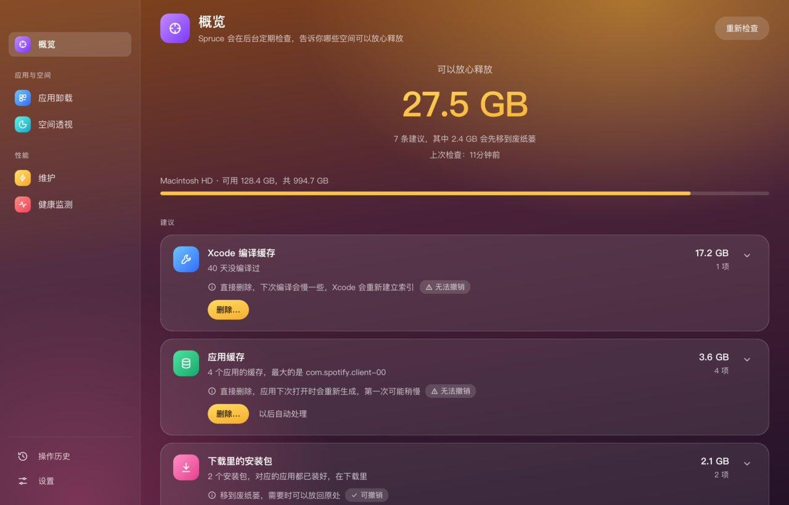
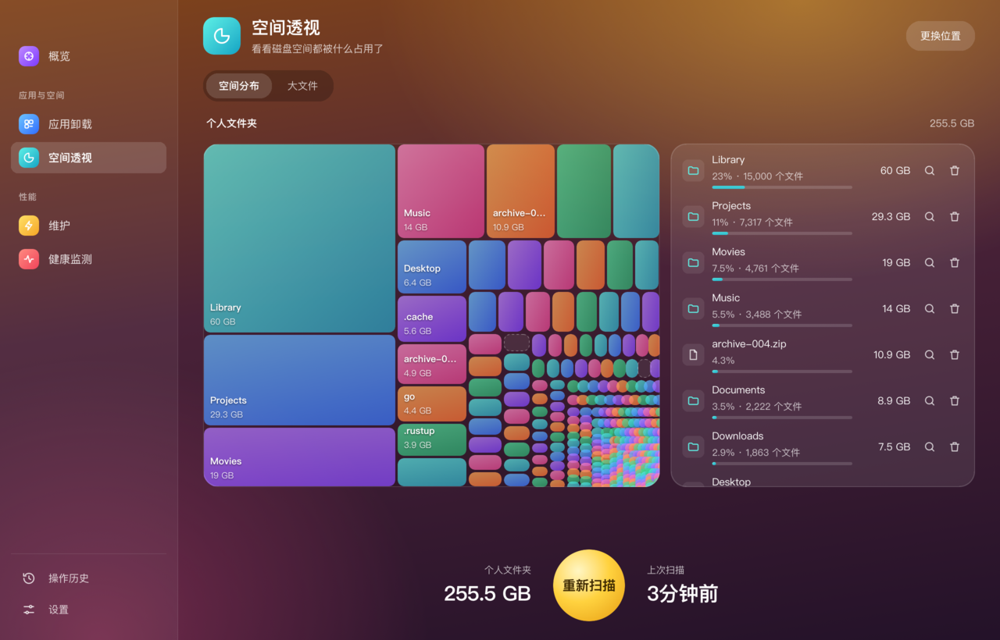
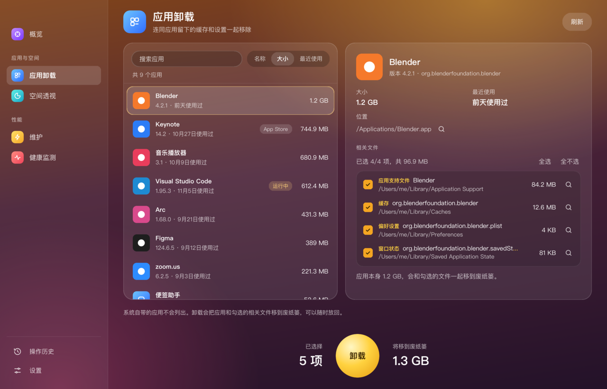
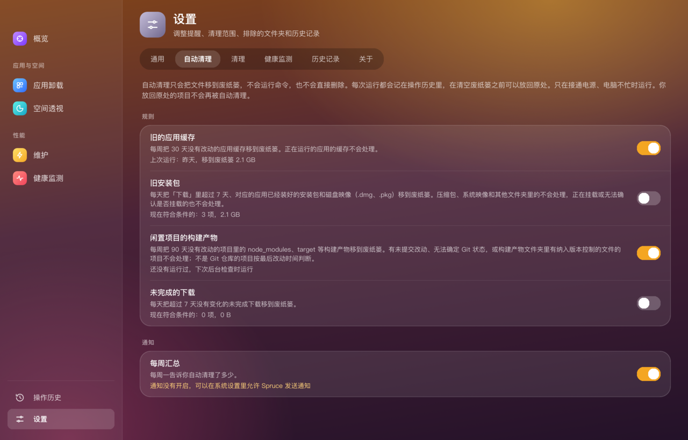
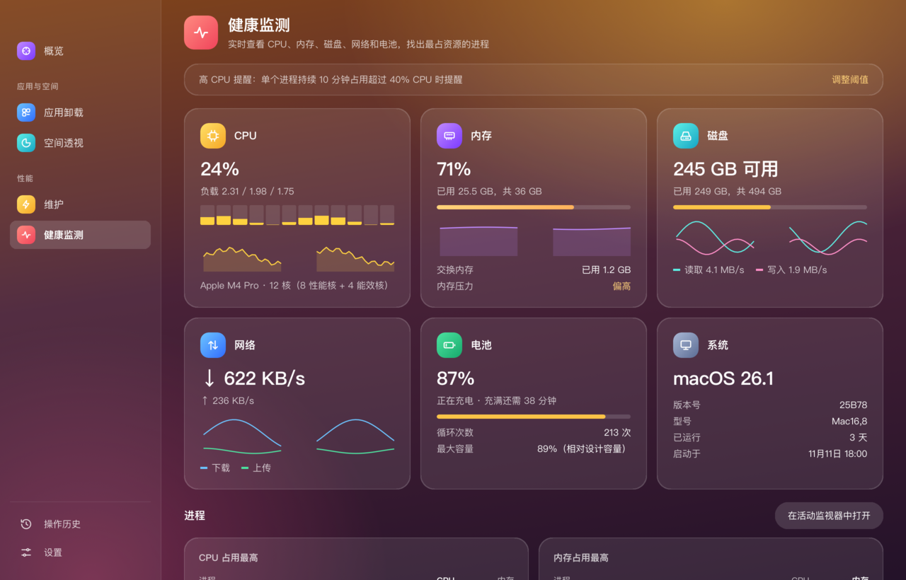

# Spruce

[](https://github.com/yldm-tech/spruce/actions/workflows/ci.yml)
[](https://github.com/yldm-tech/spruce/actions/workflows/release.yml)
[](https://github.com/yldm-tech/spruce/releases)
[](LICENSE)
[](#支援的平台)

[English](README.md) · [简体中文](README.zh-CN.md) · [日本語](README.ja.md) · 繁體中文 · [한국어](README.ko.md)

Spruce 是 macOS 和 Windows 上的磁碟清理工具。它在背景檢查你的磁碟，打開它時就已經知道可以放心釋放多少空間、會清理哪些項目、為什麼，以及能不能還原。它還能解除安裝應用程式、查看磁碟被什麼佔滿、用量如何增加、執行維護工作、監測系統健康。Spruce 以 Go 撰寫，基於 [NSGo](https://github.com/nsgo-dev/nsgo)。網站：[spruce.yldm.ai](https://spruce.yldm.ai/zh-TW/)。

介面為簡體中文，所以截圖都是簡體中文；下文引用的介面文字照應用程式原樣保留，並附上說明。



## 功能

- **總覽（概览）。** 沒有掃描按鈕。Spruce 會在打開視窗時以及在背景中檢查三個唯讀來源：系統垃圾、開發者和安裝檔（安装包），直接告訴你結論（「可以放心释放 18.7 GB」）、上次檢查的時間，並提供「重新检查」按鈕。上次的結果會在下次啟動時先顯示，同時進行新的檢查，但永遠不會根據快取的結果清理。
- **給建議，而不是一長串核取方塊。** 每張卡片是一項具體操作，寫明原因和後果，例如 Xcode 編譯快取、閒置專案的建置產物、下載項目裡的安裝檔，依大小和安全程度排序，只有一個按鈕，具體項目收在展開區域裡。每張卡片都寫明是移到垃圾桶（可還原）、刪除會自動重新產生的檔案，還是執行工具內建的指令。正在執行的應用程式的快取、最近的安裝檔、有未提交變更的專案等需要你判斷的項目，會另外計入「需要你判断」，預設不選取。
- **還原（macOS）。** 移到垃圾桶會立即完成，並顯示「已移到废纸篓 3.1 GB · 撤销」，按「撤销」即可放回。在操作記錄（操作历史）裡，30 天內、仍在垃圾桶裡的項目都可以「放回原处」，不會覆蓋原位置上現有的檔案。
- **空間透視。** 用一張圖看清任何資料夾裡各項目佔了多少空間，再列出最大的檔案；可以打開、在 Finder 或檔案總管中顯示，或移到垃圾桶。Spruce 每天記錄一次主要位置（快取、下載項目、桌面、文件、媒體資料夾、垃圾桶、開發者快取、專案資料夾）的大小，保留 90 天，可以查看最近 24 小時、7 天或 30 天裡哪些位置在變大。
- **開發者。** 列出每個專案的最後活動時間、建置產物（node_modules、target、.next 等，支援 Node、Rust、Maven、Gradle、CocoaPods、SwiftPM、Python、.NET、Zig 和 Flutter 專案）的大小和 Git 狀態。有未提交變更、或建置產物裡有納入版本控制的檔案的專案永遠不會被選取或清理，刪除前還會再查一次 Git；沒有 Git 或 Git 出錯時標為「无法确定」，不會選取。工具快取（Xcode、Homebrew、npm、pnpm、Yarn、Go、Cargo、Gradle、JetBrains 等）有內建清理指令的就用它的指令。
- **系統垃圾。** 應用程式和瀏覽器快取、未完成的下載、記錄檔、當機報告、暫存檔，以及 Windows 上的錯誤報告。不包括瀏覽器的 Cookie、瀏覽記錄和登入資訊；正在執行的應用程式和瀏覽器的快取不會選取。
- **解除安裝（应用卸载）。** 在 macOS 上，應用程式本身和你勾選的殘留檔案（Application Support、Caches、Preferences、Containers、Saved State、LaunchAgents 等）會移到垃圾桶，可以放回；不列出 Apple 內建的應用程式，正在執行的應用程式無法移除。在 Windows 上，Spruce 先執行程式內建的解除安裝程式，再列出它在 `%APPDATA%` 和 `%LOCALAPPDATA%` 裡留下的檔案，可以移到資源回收筒；不列出 Microsoft Store 的應用程式。
- **維護。** macOS：清除 DNS 快取、檢查 Spotlight 索引、重新整理 Quick Look 預覽、重建圖示快取、修復「打開檔案的應用程式」選單、最佳化 Safari、郵件和訊息的資料庫（需要完整磁碟取用權限）。Windows：清除 DNS 快取、重新整理圖示快取、清除縮圖快取、清理失效的「開啟檔案」項目、檢查 Windows Search。在 macOS 上，清除 DNS 快取和重建出錯的 Spotlight 索引需要管理員權限，每次執行只問一次；在 Windows 上，只有檢查 Windows Search 時才會要求管理員權限，而且只在該服務設為自動啟動卻已停止時才要求。
- **健康監測。** 每個核心的 CPU、記憶體和記憶體壓力、磁碟讀寫和網路傳輸速度、電池、系統資訊、佔用 CPU 和記憶體最多的處理程序；單一處理程序長時間佔用過多 CPU 時顯示提醒。Spruce 只顯示處理程序，不會結束處理程序。
- **自動清理（macOS）。** 四條規則，預設都關閉：舊的應用程式快取（30 天沒有變更，每週）、下載項目裡超過 7 天且對應應用程式已安裝的安裝檔（每天）、閒置 90 天且 Git 乾淨的專案的建置產物（每週）、7 天沒有變化的未完成下載（每天）。規則在背景檢查之後執行，只會把檔案移到垃圾桶，不執行指令，不會再處理你放回原處的項目，每次執行都記在操作記錄裡，可以放回原處。每週摘要（每周汇总）在每週一送出。
- **選單列和空間不足提醒（macOS）。** 選單列圖示顯示可用空間，空間不足時圖示會改變；關閉視窗後 Spruce 會留在選單列。可以開啟提醒（預設關閉，門檻預設 20 GB）：啟動磁碟的可用空間低於你設定的值時提醒一次，再少 5 GB 才會再次提醒，每天最多一次。
- **命令列。** 同一個執行檔也接受指令，見[命令列](#命令列)。






## 安全

- **檢查只讀取。** 背景檢查不會刪除檔案、不會執行指令，也不會跳出權限請求。最多每 6 小時一次（啟動 2 分鐘後第一次），只在接上電源、未開啟低耗電模式、電腦不熱也不忙（CPU 不超過 40%）時進行，清理進行中不會檢查。會跳出權限請求的資料夾（桌面、文件、下載項目、iCloud 雲碟、其他磁碟）只有在你手動發起的檢查讀過之後，背景才會讀取。可以在「设置 → 通用 → 在后台定期检查」裡關閉背景檢查。
- **按下之前就標清楚。** 直接刪除、執行工具指令和清空垃圾桶一定會先確認，而且無法還原，卡片上會寫明。
- **動手前再查一次。** 每個項目在移走或刪除前都會重新檢查；檢查之後有變化、正在使用，或所屬專案有了新變更的，都會略過。
- **不碰檢查範圍以外的東西。** Spruce 只處理檢查過的資料夾裡的項目，遵守你設定的排除資料夾和規則，不會順著符號連結跑到別處。系統資料夾、鑰匙圈、iCloud 雲碟和其他雲端資料夾、郵件和訊息、`~/.ssh`、文件、桌面和圖片裡的東西永遠不會被直接刪除，只能移到垃圾桶。
- **不會自己動手。** Spruce 不會自己執行指令、直接刪除、清空垃圾桶、解除安裝、放回檔案或做維護。你開啟的自動規則也只會把檔案移到垃圾桶。
- **資料只留在你的電腦上。** 不需要帳號。設定、歷史記錄和空間快照都存在 Spruce 的資料夾裡，只有你能讀取（見[資料夾](#資料夾)）。



## 支援的平台

Spruce 支援 macOS（Apple 晶片和 Intel）和 Windows（x64 和 arm64），沒有 Linux 版。

在 Windows 上還無法保證流程能在無人操作時安全進行或可以還原，所以 Windows 版暫時少了一些 macOS 版的功能：

- 沒有系統匣圖示：關閉視窗即結束 Spruce，登入時照常打開視窗；
- 背景檢查和空間不足提醒只在 Spruce 打開期間進行；
- 移到資源回收筒前會先確認，沒有「撤销」和「放回原处」（請從資源回收筒還原），也沒有 `spruce restore`；
- 沒有自動清理規則和每週摘要。

建議卡片、分類檢視、專案、空間變化和命令列與 macOS 版相同。

## 安裝

從 [GitHub Releases](https://github.com/yldm-tech/spruce/releases) 或 [spruce.yldm.ai](https://spruce.yldm.ai/zh-TW/) 下載最新版本。依你的系統選擇檔案，其中 `<version>` 是版本號，例如 `0.1.0`：

- macOS：Apple 晶片選 `spruce-<version>-macos-arm64.dmg`，Intel 選 `spruce-<version>-macos-x64.dmg`。打開磁碟映像檔，把 Spruce 拖到「應用程式」。磁碟映像檔已用 Developer ID 簽署並經過 Apple 公證。
- Windows：大多數電腦選 `spruce-<version>-windows-x64-setup.exe`，Windows on Arm 電腦選 `spruce-<version>-windows-arm64-setup.exe`。執行安裝程式即可，只為目前使用者安裝。安裝程式暫時沒有程式碼簽章，SmartScreen 可能會在執行前警告：按「其他資訊」，再按「仍要執行」。

也可以執行版本附帶的安裝指令碼：它會下載適合你電腦的安裝檔，用 `.sha256` 驗證後安裝。在 macOS 上會把應用程式裝到 `/Applications`，沒有寫入權限時裝到 `~/Applications`：

```sh
curl -fsSL https://github.com/yldm-tech/spruce/releases/latest/download/install.sh | sh
```

在 Windows 上，在 PowerShell 裡執行：

```powershell
irm https://github.com/yldm-tech/spruce/releases/latest/download/install.ps1 | iex
```

每個版本的 `checksums.txt` 列出所有檔案的 SHA-256。Spruce 不會自動更新：下載新版本，或再次執行安裝指令碼即可。

在 macOS 上，完整磁碟取用權限是選用的。最佳化 Safari、郵件和訊息的資料庫、讀取垃圾桶、尋找部分應用程式的殘留檔案、在空間快照裡計入其他應用程式的容器時需要它；背景檢查從不請求這項權限。



## 命令列

在執行檔後面加上指令來執行：macOS 上是 `Spruce.app/Contents/MacOS/Spruce <指令>`，Windows 上是 `Spruce.exe <指令>`。只有 `clean --yes` 和 `restore --yes` 會刪除或變更你的檔案。說明裡把它稱為 `spruce`；想這樣輸入的話，在 macOS 上把它連結到 PATH 裡（`ln -s /Applications/Spruce.app/Contents/MacOS/Spruce /usr/local/bin/spruce`），在 Windows 上加入別名（在 PowerShell 設定檔裡寫 `Set-Alias spruce "$env:LOCALAPPDATA\Programs\Spruce\Spruce.exe"`）。

| 指令 | 作用 |
|---|---|
| `scan [--source system-junk\|dev-junk\|installers]... [--json]` | 檢查並列出各類別的大小和項目數。 |
| `recommendations [--json]`（或 `list`） | 檢查並列出建議卡片：ID、標題、大小、操作和原因。 |
| `clean [<recommendation-id>...] [--category <source:category>]... [--source <id>]... [--older-than 12h\|30d\|2w] [--yes \| --dry-run] [--json]` | 檢查、選取並印出計畫；只有加上 `--yes` 才會刪除。不指定 ID 時，選取所有不執行指令的建議；只有指名的建議才會執行指令。它經過與應用程式相同的檢查，並記入操作記錄。 |
| `projects [--json]` | 檢查專案資料夾，列出專案、建置產物和 Git 狀態。 |
| `history [--limit 20] [--json]` | 列出最近的記錄，以及能否放回原處。 |
| `restore <run-id> [--yes] [--json]` | 僅限 macOS：列出一筆記錄移到垃圾桶、還能放回的項目；只有加上 `--yes` 才會放回。 |
| `help [<command>]`、`version` | 說明和版本。 |

加上 `--json`（`help` 以外的所有指令都支援）時，標準輸出是一個 JSON 物件（`{"version":1,"command":...}` 或 `{"version":1,"error":...}`），記錄寫到標準錯誤。結束代碼：0 成功（包括沒有可做的事和試執行），1 失敗，2 用法錯誤，3 部分完成（有項目失敗或被保留），4 忙碌（應用程式或另一個指令正在清理），130 被中斷。

應用程式和命令列共用資料夾裡的一把鎖，所以不會同時清理。關閉終端機或 SSH 斷線會像 Ctrl+C 一樣，在處理完目前的項目後停止清理，並且照樣記錄。命令列拒絕以 root 身分執行：在 `sudo` 下，它寫進資料夾的檔案，應用程式將無法開啟；移走的檔案也不會進到你的垃圾桶。

在 macOS 上，命令列的隱私權限屬於執行它的終端機應用程式，而不是 Spruce.app：想在終端機裡完整檢查，需要在「系統設定」裡給這個終端機完整磁碟取用權限。

在 Windows 上，執行檔是圖形介面程式，`cmd.exe` 不會等它結束：請用 `start /wait Spruce.exe scan`，或在 PowerShell 裡用 `[Console]::OutputEncoding = [Text.UTF8Encoding]::new(); .\Spruce.exe scan | Out-Host`。輸出是 UTF-8，所以在其他管線或重新導向之前也要這樣設定 `[Console]::OutputEncoding`，否則中文和 JSON 字串會變成亂碼。

## 資料夾

Spruce 的資料存在 macOS 的 `~/Library/Application Support/Spruce` 和 Windows 的 `%AppData%\Spruce`。檔案權限為 0600，資料夾為 0700；檔案以不可分割的方式取代或逐行附加，當機不會留下寫了一半的檔案。損壞的檔案或其他版本的檔案會被忽略，並在下次儲存時取代。

| 檔案 | 內容 | 上限 |
|---|---|---|
| `settings.json` | 設定 | |
| `history.jsonl` | 操作記錄，每次執行一行 JSON | 500 次 |
| `overview-cache.json` | 上次檢查的結果，只用於顯示（從不用來刪除） | 8 MB，顯示 7 天 |
| `undo/` | 每次執行移到垃圾桶的項目、進行中的清理的日誌，以及已放回的項目（自動規則不會再處理它們） | 200 筆、32 MB、30 天 |
| `growth/` | 每天的空間快照 | 40 個檔案、8 MB、90 天 |
| `background.json` | 各條自動規則上次執行的時間、上次的每週摘要、空間不足提醒的狀態 | 很小 |
| `folder-access.json` | 你手動發起的檢查讀過的、會跳出權限請求的資料夾 | 很小 |
| `clean.lock` | 應用程式和命令列在清理或檢查時共用的鎖 | |
| `instance.lock`、`instance.sock` | 單一實例鎖，以及再次啟動時用來把正在執行的 Spruce 帶到最前面的通訊端 | |
| `window.json`、`app-icons/` | 視窗位置和快取的應用程式圖示 | |

操作記錄裡的「清空历史」也會刪除還原記錄（不包括已放回項目的清單）、快取的結果和空間快照。

## 從原始碼建置

需要 Go 1.27.3 或更新版本：

```sh
git clone https://github.com/yldm-tech/spruce.git
cd spruce
make build
```

`make build` 為目前的平台執行 `go tool nsgo build`（用 `TARGET=` 建置其他平台，例如 `make build TARGET=windows_x64`），應用程式寫到 `apps/spruce/build/`，用於散布的檔案寫到 `apps/spruce/build/releases/`：macOS 上是臨時簽署的 `Spruce.app` 和 `.dmg`；Windows 上是程式本身，裝有 `makensis` 時還有 NSIS 安裝程式。Windows 版不需要 cgo，可以在任何平台交叉編譯。沒有 `make` 時（例如未安裝額外工具的 Windows），在儲存庫根目錄執行 `go tool nsgo build -target windows_x64 apps/spruce`。`nsgo` 是應用程式的 Go 工具相依套件，`go tool nsgo` 不需要另外安裝任何東西。

## 開發

儲存庫根目錄是一個 Go 工作區（`go.work`），應用程式是 `apps/spruce` 裡的模組。

```sh
make test   # go test ./apps/spruce/...
make dev    # 執行應用程式，每次變更後重新建置並重新啟動
make build  # 為目前的平台建置應用程式，輸出到 apps/spruce/build
make check  # CI 執行的全部檢查（apps/spruce/scripts/check.sh）
```

`make check` 依序執行：gofmt，兩種架構的 macOS 和 Windows 的 vet 和建置，檢查 `apps/spruce/resources/THIRD_PARTY_NOTICES.txt` 與連結的模組一致，啟用競爭條件偵測（race detector）的測試，golangci-lint v2（需要用不低於 `apps/spruce/go.mod` 中版本的 Go 建置），無介面的 nsgo 測試，以及 nsgo check。視窗測試用固定的測試資料把每個頁面置於主要狀態，在 macOS 上用 `go tool nsgo test -target macos apps/spruce` 在真實視窗中截圖（加 `-run 'TestScreensSpace'` 只跑部分頁面）；截圖存在 `apps/spruce/.nsgo/test/screenshots/<target>`。

`nsgo dev` 和 `nsgo test -target macos` 對應用程式做臨時簽署並從終端機啟動，所以依賴應用程式身分的功能（完整磁碟取用權限、登入項目、需要提升權限的維護工作）要用 `nsgo build` 建置的應用程式來驗證。

儲存庫結構：

- `apps/spruce/main.go`、`wire.go`：啟動、單一實例檢查和引擎的組裝。
- `apps/spruce/internal/engine/`：掃描、清理、解除安裝、維護、歷史、設定和系統資訊，不依賴介面。
- `apps/spruce/internal/app/`：介面呼叫的控制器，位於引擎和頁面之間。
- `apps/spruce/internal/cli/`：命令列。
- `apps/spruce/internal/host/`：資料夾、單一實例、登入項目、完整磁碟取用權限和背景讀取的限制。
- `apps/spruce/internal/ui/`：外殼（視窗、選單列、通知）、各個頁面、設計系統（`kit`）和全域狀態。
- `docs/assets/`：README 和網站共用的圖示和截圖。

## CI 和發布

[CI](https://github.com/yldm-tech/spruce/actions/workflows/ci.yml) 工作流程在 GitHub 代管的執行器上檢查提取要求和 `main`。[Release](https://github.com/yldm-tech/spruce/actions/workflows/release.yml) 工作流程在 `main` 的 CI 通過後執行：根據上一個標籤之後的 Conventional Commits 決定下一個版本（範圍為 `site` 的變更不會發布新版本），把版本號連同[變更記錄](apps/spruce/CHANGELOG.md)裡的對應章節以 `chore(release)` 提交到 `main` 並加上標籤，建置簽署並公證的 macOS 磁碟映像檔和 Windows 安裝程式，然後發布 GitHub Release，附上安裝檔、檢查碼和建置來源證明。

## 授權

[MIT](LICENSE)。附帶的 Inter 字型採用 SIL Open Font License 1.1（[apps/spruce/resources/fonts/Inter-LICENSE.txt](apps/spruce/resources/fonts/Inter-LICENSE.txt)）；第三方程式庫及其授權列在應用程式的「设置 → 关于 → 开源许可」裡，它們的授權和聲明全文隨每個安裝檔附上，見 [apps/spruce/resources/THIRD_PARTY_NOTICES.txt](apps/spruce/resources/THIRD_PARTY_NOTICES.txt)。
